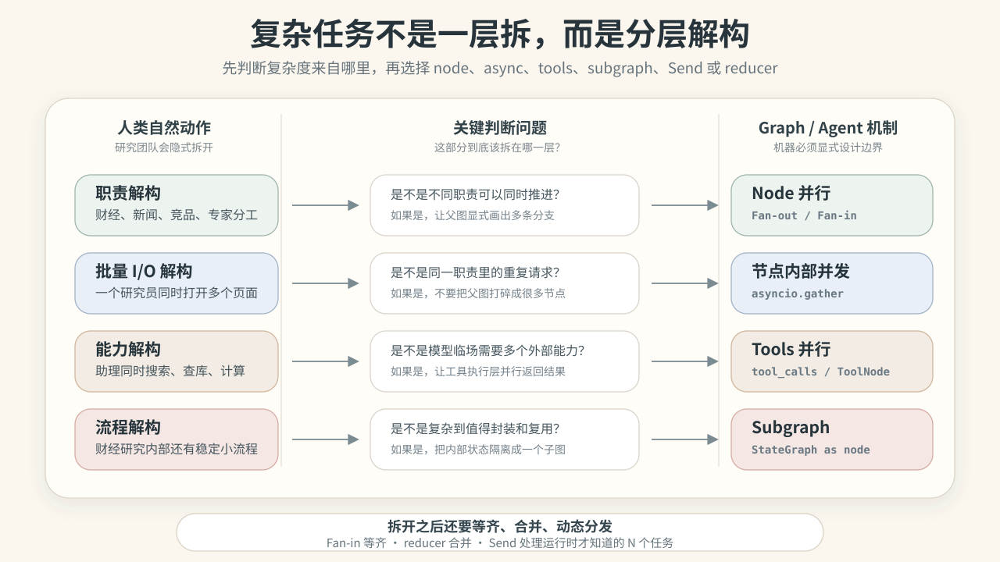
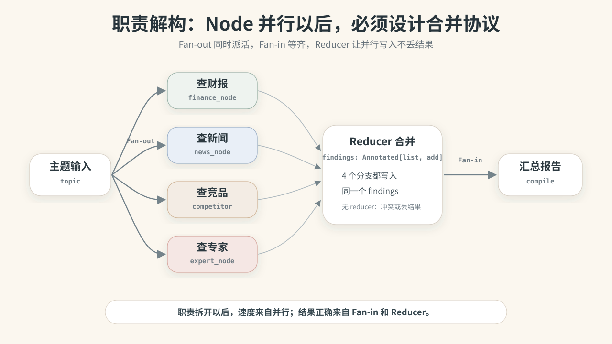
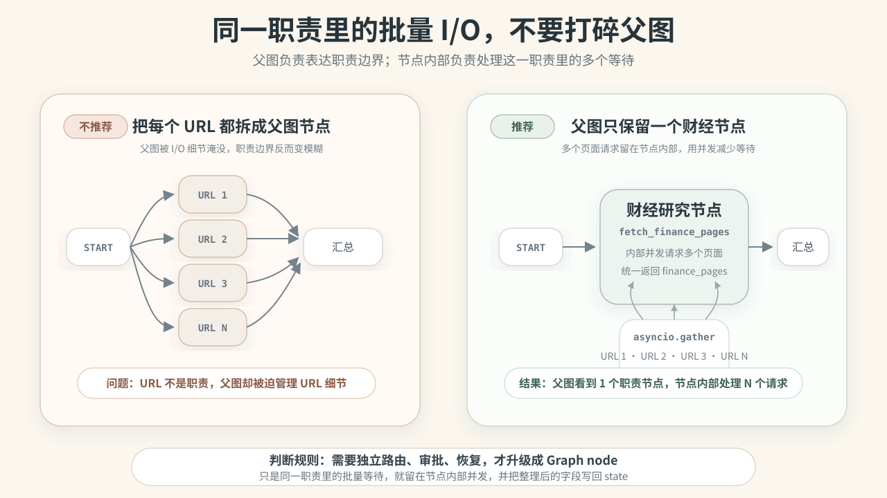
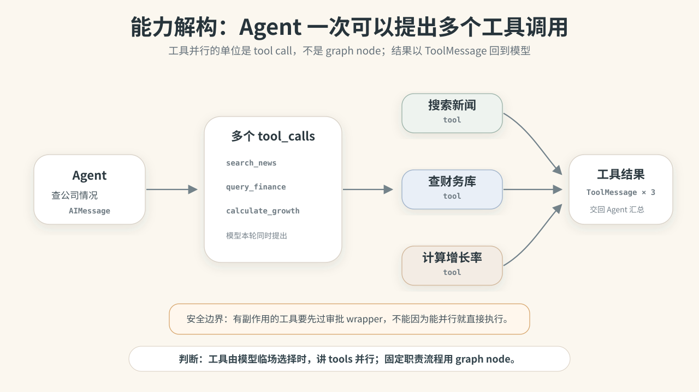
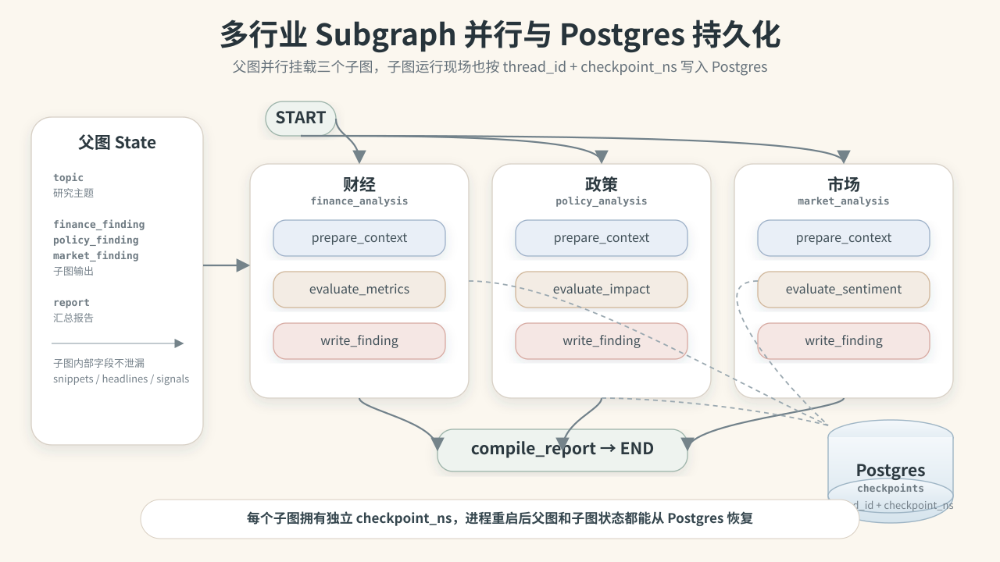

# LG-05：复杂任务的分层解构

> **核心冲突句：人类会自然把复杂任务拆成层次，但图不会；图只知道哪些职责被拆成节点、哪些重复工作被批量执行、哪些工具能一起调用、哪些内部流程要封装成子图。**

这节课从一个真实 Agent 产品场景开始：你要做一个 **ResearchForge 行业研究助手**。用户只给一句话：

> “请快速判断新能源汽车供应链公司 Q2 是否值得继续跟踪。”

人类研究团队会自然拆开这件事：有人看财务，有人看新闻，有人看竞品，有人看专家观点；财经研究员自己还会同时翻多个页面；Agent 可能一次调用搜索、数据库、计算器；财经研究内部如果越来越复杂，就会升级成一个可复用的研究小组。

Graph / Agent 不会自然这样做。本节课要训练的判断不是“哪个 API 更高级”，而是：**复杂任务应该在哪一层拆，拆开后如何提速、合并、复用、扩展。**

## 0. 为什么会需要并行、tools、subgraph / subagent？

ResearchForge 会同时遇到四类压力：

| 压力 | 如果不拆会怎样 | 需要的机制 |
|---|---|---|
| 速度 | 财务、新闻、竞品、专家依次等，用户等很久 | node 并行 |
| 效率 | 一个财经节点内部要查多段材料，逐条等很慢 | 节点内部并发 |
| 能力 | Agent 临场发现要搜索、查库、计算，固定边写不完 | tools 并行 |
| 结构与拓展 | 财经研究内部越来越复杂，父图越来越乱，能力也难复用 | subgraph；更进一步是 subagent |

注意：`tools`、`subgraph` 和 `subagent` 都是在做“复杂能力的原子化”。工具把外部能力原子化，方便被不同 Agent 复用；子图把稳定流程原子化，方便被不同父图复用；subagent 则把更自治的专家角色原子化。

<div style="max-width: 980px; margin: 1rem auto;">
  
</div>

## 1. 模型配置：本节用真实 LLM，不用假研究员

这一课讲的是 Agent / Graph 如何拆解真实 LLM 工作流，所以后面所有研究、摘要、工具选择都走真实模型。

需要在项目根目录 `.env` 或当前环境中配置：

```bash
OPENAI_MODEL=deepseek-v4-flash
OPENAI_BASE_URL=https://dashscope.aliyuncs.com/compatible-mode/v1
OPENAI_API_KEY=你的 key
OPENAI_TEMPERATURE=0
```

缺配置时直接报错，不做 fake fallback。这样学生不用同时理解“假模拟器”和“真实机制”。

```python
from typing import Annotated, TypedDict
from operator import add
import asyncio
import json
import sys
import time
from pathlib import Path

from langchain_core.messages import HumanMessage, SystemMessage, ToolMessage
from langchain_core.prompts import ChatPromptTemplate
from langchain_core.tools import tool
from langgraph.graph import END, START, StateGraph
from langgraph.types import Send

chapter_dir = Path.cwd()
if not (chapter_dir / "subgraphs_demo_support.py").exists():
    chapter_dir = Path("turtorial/LG-05-subgraphs")
sys.path.append(str(chapter_dir.resolve()))

from subgraphs_demo_support import chat_model, display_bool, parse_json_message, print_json

research_topic = "新能源汽车供应链公司 Q2 是否值得继续跟踪"
print("模型已加载:", chat_model.__class__.__name__)
print("研究主题:", research_topic)
```

**输出**

```text
模型已加载: ChatOpenAI
研究主题: 新能源汽车供应链公司 Q2 是否值得继续跟踪
```

## 2. 先写 Prompt：让模型输出可合并的研究 JSON

Prompt 是教学材料，不能藏在函数里。我们先把“研究员”节点要用的系统提示词和用户提示词写清楚。

每个研究员只负责一个角度，并返回结构化 JSON。这样后面的 Reducer 才能把多个发现合并成一个列表。

```python
research_system_prompt = """
你是 ResearchForge 的一个专业研究员。
你只负责自己的研究角度，不要写完整报告。
请只返回 JSON，不要 Markdown，不要代码块。
JSON 字段：
- role: 你的研究角色
- finding: 一句话核心发现
- evidence: 2 条简短证据列表
- risk: 一个需要继续核实的风险
- next_question: 下一步应该追问的问题
""".strip()

research_user_prompt_template = """
研究主题：{topic}
你的角色：{role}
研究重点：{focus}

请基于常识和行业研究视角，给出可被汇总节点使用的研究发现。
""".strip()

research_prompt = ChatPromptTemplate.from_messages([
    ("system", research_system_prompt),
    ("human", research_user_prompt_template),
])

research_roles = [
    ("财经研究员", "收入增长、利润率、现金流、费用压力"),
    ("新闻研究员", "近期舆情、政策变化、市场情绪"),
    ("竞品研究员", "主要竞争对手、份额变化、差异化优势"),
    ("专家观点研究员", "机构观点、产业专家担忧、长期趋势"),
]

print("研究员数量:", len(research_roles))
print("Prompt 是否要求 JSON:", "是")
print("研究角度:", [role for role, _ in research_roles])
```

**输出**

```text
研究员数量: 4
Prompt 是否要求 JSON: 是
研究角度: ['财经研究员', '新闻研究员', '竞品研究员', '专家观点研究员']
```

## 3. Baseline：一个 Agent 串行做完所有研究

先不要上 Graph。我们让同一个程序依次调用四次 LLM，模拟一个人按顺序做四类研究。

这个 baseline 要证明两个问题：

1. **速度问题**：四个独立研究角度依次等待。
2. **结构问题**：虽然能完成，但职责边界只是藏在 for-loop 里，图看不见，也无法单独调度。

```python
def run_research_role(topic: str, role: str, focus: str, start_time: float | None = None) -> dict:
    if start_time is not None:
        print(f"[{time.perf_counter() - start_time:6.2f}s] 开始 {role} ...")
    prompt_value = research_prompt.invoke({"topic": topic, "role": role, "focus": focus})
    response = chat_model.invoke(prompt_value)
    finding = parse_json_message(response)
    if start_time is not None:
        print(f"[{time.perf_counter() - start_time:6.2f}s] 完成 {role}")
    return finding

serial_start = time.perf_counter()
serial_findings = [
    run_research_role(research_topic, role, focus, start_time=serial_start)
    for role, focus in research_roles
]
serial_elapsed = time.perf_counter() - serial_start

print("串行 LLM 研究次数:", len(serial_findings))
print("串行执行耗时:", f"{serial_elapsed:.2f} 秒")
print("是否能看到 Graph 职责边界:", "否 — 职责只藏在 for-loop 里")
print_json("串行研究样例:", serial_findings[0])
```

**输出**

```text
[  0.00s] 开始 财经研究员 ...
[  2.34s] 完成 财经研究员
[  2.34s] 开始 新闻研究员 ...
[  6.32s] 完成 新闻研究员
[  6.32s] 开始 竞品研究员 ...
[ 10.34s] 完成 竞品研究员
[ 10.34s] 开始 专家观点研究员 ...
[ 13.21s] 完成 专家观点研究员
串行 LLM 研究次数: 4
串行执行耗时: 13.21 秒
是否能看到 Graph 职责边界: 否 — 职责只藏在 for-loop 里
串行研究样例:
{
  "role": "财经研究员",
  "finding": "Q2新能源供应链公司收入增速放缓，毛利率承压，现金流分化明显，费用压力主要来自研发和销售投入。",
  "evidence": [
    "乘联会数据：2024年Q2新能源乘用车零售销量同比增长约28%，低于Q1的34%，增速放缓导致供应链订单增速回落。",
    "宁德时代2024H1财报：Q2营收环比增长7%，但毛利率降至25.3%（同比-2.8pct），经营性现金流净额同比下滑12%。"
  ],
  "risk": "下游整车厂持续压价叠加碳酸锂价格低位震荡，供应链公司毛利率可能进一步下滑，部分中小公司现金流可能转负。",
  "next_question": "头部供应链公司Q2应收账款周转天数是否同比延长？坏账计提比例有无变化？"
}
```

从上面的时间线可以清楚地看到：四个研究角度是一个接一个执行的，每个都要等上一个完全结束后才开始。这就是串行 baseline 的速度瓶颈。

串行 baseline 能得到答案，但它没有把“财经、新闻、竞品、专家”变成图里的结构。后面如果要加审批、缓存、重试、替换某个研究模块，都会变得困难。

所以我们不是为了炫技才并行，而是因为：**职责已经独立，图应该把这个独立性显式表达出来。**

## 4. Node 并行：把独立职责拆成 Graph 节点

四个研究角度互不依赖，适合拆成四个 node 并行执行。

<div style="max-width: 980px; margin: 1rem auto;">
  
</div>

这里的并行发生在 **Graph 调度层**：开发者明确画出四条分支，汇总节点等齐所有发现后再生成报告。

```python
class ResearchState(TypedDict):
    topic: str
    findings: Annotated[list[dict], add]
    report: str
    # 仅用于在输出里画出并行时间线，不是业务状态。
    start_time: float
async def run_research_role_async(topic: str, role: str, focus: str, start_time: float | None = None) -> dict:
    if start_time is not None:
        print(f"[{time.perf_counter() - start_time:6.2f}s] 开始 {role} ...")
    prompt_value = research_prompt.invoke({"topic": topic, "role": role, "focus": focus})
    response = await chat_model.ainvoke(prompt_value)
    finding = parse_json_message(response)
    if start_time is not None:
        print(f"[{time.perf_counter() - start_time:6.2f}s] 完成 {role}")
    return finding
async def finance_node(state: ResearchState) -> dict:
    finding = await run_research_role_async(state["topic"], "财经研究员", "收入增长、利润率、现金流、费用压力", start_time=state["start_time"])
    return {"findings": [finding]}
async def news_node(state: ResearchState) -> dict:
    finding = await run_research_role_async(state["topic"], "新闻研究员", "近期舆情、政策变化、市场情绪", start_time=state["start_time"])
    return {"findings": [finding]}
async def competitor_node(state: ResearchState) -> dict:
    finding = await run_research_role_async(state["topic"], "竞品研究员", "主要竞争对手、份额变化、差异化优势", start_time=state["start_time"])
    return {"findings": [finding]}
async def expert_node(state: ResearchState) -> dict:
    finding = await run_research_role_async(state["topic"], "专家观点研究员", "机构观点、产业专家担忧、长期趋势", start_time=state["start_time"])
    return {"findings": [finding]}
report_system_prompt = """
你是 ResearchForge 的主笔。
请根据多位研究员的 JSON 发现，写一个简短结论。
只返回 JSON，字段：decision, summary, key_reasons, open_risks。
""".strip()
report_user_prompt_template = """
研究主题：{topic}
研究员发现：{findings_json}
""".strip()
report_prompt = ChatPromptTemplate.from_messages([
    ("system", report_system_prompt),
    ("human", report_user_prompt_template),
])
async def compile_report_node(state: ResearchState) -> dict:
    prompt_value = report_prompt.invoke({
        "topic": state["topic"],
        "findings_json": json.dumps(state["findings"], ensure_ascii=False),
    })
    response = await chat_model.ainvoke(prompt_value)
    report = parse_json_message(response)
    return {"report": json.dumps(report, ensure_ascii=False, indent=2)}
parallel_builder = StateGraph(ResearchState)
parallel_builder.add_node("finance", finance_node)
parallel_builder.add_node("news", news_node)
parallel_builder.add_node("competitor", competitor_node)
parallel_builder.add_node("expert", expert_node)
parallel_builder.add_node("compile_report", compile_report_node)
# 四条分支从 START 并行出发：从 START 到每个研究节点各画一条边。
# 四条分支再 fan-in 到 compile_report：add_edge(start_key, end_key) 的 start_key 传入节点列表，
# LangGraph 会创建一个 join barrier，只有列表里的所有节点都执行完毕，
# 下游节点才会被触发。这里 compile_report 会等 finance/news/competitor/expert 全部完成后才运行。
# 注意：这不是“任一完成就触发”，也不是“来一个处理一个”的流式语义。
research_nodes = ["finance", "news", "competitor", "expert"]
for node in research_nodes:
    parallel_builder.add_edge(START, node)
parallel_builder.add_edge(research_nodes, "compile_report")
parallel_builder.add_edge("compile_report", END)
parallel_graph = parallel_builder.compile()
parallel_start = time.perf_counter()
parallel_result = await parallel_graph.ainvoke({
    "topic": research_topic,
    "findings": [],
    "report": "",
    "start_time": parallel_start,
})
parallel_elapsed = time.perf_counter() - parallel_start
print("并行 LLM 研究节点数:", len(parallel_result["findings"]))
print("并行执行耗时:", f"{parallel_elapsed:.2f} 秒")
print("是否等齐四类发现后生成报告:", display_bool(bool(parallel_result["report"])))
print("Reducer 是否保留全部发现:", display_bool(len(parallel_result["findings"]) == 4))
print("\n汇总报告 JSON:")
print(parallel_result["report"])
```

**输出**

```text
[  0.00s] 开始 竞品研究员 ...
[  0.00s] 开始 专家观点研究员 ...
[  0.01s] 开始 财经研究员 ...
[  0.01s] 开始 新闻研究员 ...
[  3.11s] 完成 财经研究员
[  4.00s] 完成 竞品研究员
[  5.60s] 完成 专家观点研究员
[  5.70s] 完成 新闻研究员
并行 LLM 研究节点数: 4
并行执行耗时: 8.63 秒
是否等齐四类发现后生成报告: 是
Reducer 是否保留全部发现: 是

汇总报告 JSON:
{
  "decision": "谨慎跟踪，聚焦头部与差异化企业",
  "summary": "新能源汽车供应链公司Q2整体面临收入增速放缓、毛利率承压、费用上升等挑战，但头部企业凭借技术迭代和规模优势维持韧性，二三线企业通过差异化策略实现微弱份额增长。政策利好与价格战压力并存，市场情绪偏谨慎。建议重点关注具备技术壁垒和成本控制能力的龙头企业，并警惕产能过剩、库存减值及海外贸易壁垒等风险。",
  "key_reasons": [
    "头部电池供应商（宁德时代、比亚迪）市占率稳定，合计超70%，技术迭代持续；二线企业通过钠离子电池、换电等差异化策略实现份额微增。",
    "Q2收入增速普遍放缓5-10个百分点，毛利率同比下降1-3个百分点，三项费用率合计提升0.5-1.5个百分点，利润空间受挤压。",
    "政策利好（以旧换新补贴、地方消费刺激）支撑需求预期，但车企价格战加剧，碳酸锂价格低位震荡，供应链盈利承压。"
  ],
  "open_risks": [
    "部分二线电池厂产能利用率不足60%，若Q2下游需求增速放缓，可能出现低价抢单导致毛利率恶化。",
    "海外（欧盟、美国）贸易壁垒政策升级可能冲击出口型供应链公司。",
    "若新能源汽车终端销量不及预期（补贴退坡或消费疲软），供应链公司库存减值风险超预期。",
    "研发、销售、管理费用刚性可能持续侵蚀净利润，需关注各环节费用控制能力。"
  ]
}
```

对比上面的时间线和串行 baseline：四个节点几乎同时启动，研究阶段在约 4 秒内完成，总耗时从 14.42 秒降到 7.86 秒。

`add_edge(research_nodes, "compile_report")` 里的列表参数，会让 LangGraph 在内部生成一个 join barrier：必须四个研究节点全部到达后，`compile_report` 才会开始执行。这是图层的“等齐”语义，不是 for-loop 里自己数个数。

速度只是收益之一，更重要的是结构变清晰：后面你可以单独替换财经节点、给新闻节点加缓存、给专家节点加人工审批，而不用重写整条流程。

## 4.5 延迟节点：等齐，但不挡主路

四个研究节点跑完后，除了生成报告，我们可能还想“顺便”做点别的：把四份发现写入审计日志、发送监控埋点、或者更新一个长期知识库。

这些动作有两个特点：

1. 它们需要等齐四个研究节点的结果；
2. 但它们不应该让用户等报告的时间变长。

人类团队的做法很直觉：主笔去写报告，行政或审计同事在隔壁整理归档。如果 Graph 不加区分地把这两个节点都接到 fan-in 后面，它们会同时启动、竞争资源。`defer=True` 就是用来表达这种“等齐，但让主路先走”的调度语义。

```python
# 为了放大调度时间线差异，审计日志节点用 sleep 模拟 I/O；
# 真实场景里这里可以是写日志、发埋点、存外部缓存等副作用。
class DeferredResearchState(ResearchState):
    audit_saved: bool
async def save_audit_log(state: DeferredResearchState) -> dict:
    print(f"[{time.perf_counter() - state['start_time']:6.2f}s] 开始 审计日志")
    await asyncio.sleep(1.0)
    print(f"[{time.perf_counter() - state['start_time']:6.2f}s] 完成 审计日志")
    return {"audit_saved": True}

async def compile_report_with_timing(state: DeferredResearchState) -> dict:
    print(f"[{time.perf_counter() - state['start_time']:6.2f}s] 开始 主笔汇总")
    result = await compile_report_node(state)
    print(f"[{time.perf_counter() - state['start_time']:6.2f}s] 完成 主笔汇总")
    return result

def build_research_defer_graph(defer_audit: bool):
    builder = StateGraph(DeferredResearchState)
    builder.add_node("finance", finance_node)
    builder.add_node("news", news_node)
    builder.add_node("competitor", competitor_node)
    builder.add_node("expert", expert_node)
    builder.add_node("compile_report", compile_report_with_timing)
    builder.add_node("save_audit_log", save_audit_log, defer=defer_audit)
    research_nodes = ["finance", "news", "competitor", "expert"]
    for node in research_nodes:
        builder.add_edge(START, node)
    builder.add_edge(research_nodes, "compile_report")
    builder.add_edge(research_nodes, "save_audit_log")
    builder.add_edge("compile_report", END)
    builder.add_edge("save_audit_log", END)
    return builder.compile()
    
print("=== 无 defer：审计日志与主笔并行 ===")
no_defer_graph = build_research_defer_graph(defer_audit=False)
no_defer_start = time.perf_counter()
no_defer_result = await no_defer_graph.ainvoke({
    "topic": research_topic,
    "findings": [],
    "report": "",
    "start_time": no_defer_start,
    "audit_saved": False,
})
no_defer_elapsed = time.perf_counter() - no_defer_start
print(f"总耗时: {no_defer_elapsed:.2f}s")
print(f"报告已生成: {bool(no_defer_result['report'])}")
print(f"审计日志已保存: {no_defer_result['audit_saved']}")
print("\n=== 有 defer：审计日志等主路完成后执行 ===")
defer_graph = build_research_defer_graph(defer_audit=True)
defer_start = time.perf_counter()
defer_result = await defer_graph.ainvoke({
    "topic": research_topic,
    "findings": [],
    "report": "",
    "start_time": defer_start,
    "audit_saved": False,
})
defer_elapsed = time.perf_counter() - defer_start
print(f"总耗时: {defer_elapsed:.2f}s")
print(f"报告已生成: {bool(defer_result['report'])}")
print(f"审计日志已保存: {defer_result['audit_saved']}")
```

**输出**

```text
=== 无 defer：审计日志与主笔并行 ===
[  0.00s] 开始 竞品研究员 ...
[  0.01s] 开始 专家观点研究员 ...
[  0.01s] 开始 财经研究员 ...
[  0.01s] 开始 新闻研究员 ...
[  2.11s] 完成 财经研究员
[  3.24s] 完成 竞品研究员
[  4.59s] 完成 新闻研究员
[  4.63s] 完成 专家观点研究员
[  4.63s] 开始 主笔汇总
[  4.63s] 开始 审计日志
[  5.63s] 完成 审计日志
[  7.80s] 完成 主笔汇总
总耗时: 7.81s
报告已生成: True
审计日志已保存: True

=== 有 defer：审计日志等主路完成后执行 ===
[  0.00s] 开始 竞品研究员 ...
[  0.00s] 开始 专家观点研究员 ...
[  0.00s] 开始 财经研究员 ...
[  0.00s] 开始 新闻研究员 ...
[  1.85s] 完成 竞品研究员
[  2.51s] 完成 新闻研究员
[  3.19s] 完成 专家观点研究员
[  3.87s] 完成 财经研究员
[  3.87s] 开始 主笔汇总
[  6.74s] 完成 主笔汇总
[  6.74s] 开始 审计日志
[  7.75s] 完成 审计日志
总耗时: 7.75s
报告已生成: True
审计日志已保存: True
```

对比两条时间线：

- **无 `defer`**：四个研究节点完成后，`save_audit_log` 和 `compile_report` 几乎同时启动。审计日志虽然不重要，却和主笔节点抢同一个 superstep。
- **有 `defer`**：四个研究节点完成后，只有 `compile_report` 启动；`save_audit_log` 被放进延迟队列，等主笔节点完成后才执行。

`defer=True` 的适用边界：

- 节点需要等齐多个并行上游（fan-in）。
- 节点不是用户关键路径，允许晚点执行。
- 典型场景：写日志、发埋点、存审计、更新长期知识库。

注意：它**不是**“不等任何人”。`save_audit_log` 仍然要等四个研究节点全部到达；它只是不拖慢主线。

## 5. Reducer：并行 LLM 结果必须有合并协议

四个 LLM 节点都返回 `findings`。如果没有 reducer，Graph 不知道多个并行更新怎么合并。

Reducer 的作用不是“更快”，而是让拆开的并行结果能安全回到同一个 state 字段。

```python
class BadMergeState(TypedDict):
    topic: str
    findings: list[dict]


async def bad_a_node(state: BadMergeState) -> dict:
    return {"findings": [{"role": "A", "finding": "发现 A"}]}


async def bad_b_node(state: BadMergeState) -> dict:
    return {"findings": [{"role": "B", "finding": "发现 B"}]}


bad_builder = StateGraph(BadMergeState)
bad_builder.add_node("bad_a", bad_a_node)
bad_builder.add_node("bad_b", bad_b_node)
bad_builder.add_edge(START, "bad_a")
bad_builder.add_edge(START, "bad_b")
bad_builder.add_edge("bad_a", END)
bad_builder.add_edge("bad_b", END)
bad_graph = bad_builder.compile()

try:
    await bad_graph.ainvoke({"topic": research_topic, "findings": []})
except Exception as error:
    print("是否触发并行写入冲突:", "是")
    print("错误类型:", type(error).__name__)
    print("原因:", "多个并行节点写同一字段，但没有 reducer")

print("\n正确做法:", "findings: Annotated[list[dict], add]")
print("并行发现数:", len(parallel_result["findings"]))
print("是否有结果丢失:", display_bool(len(parallel_result["findings"]) == 4))
```

**输出**

```text
是否触发并行写入冲突: 是
错误类型: InvalidUpdateError
原因: 多个并行节点写同一字段，但没有 reducer

正确做法: findings: Annotated[list[dict], add]
并行发现数: 4
是否有结果丢失: 是
```

## 5. 节点内部并发：同一职责里的多个 LLM 子任务不要打碎父图

财经节点内部可能还要读多段材料：收入、利润率、现金流、费用。它们都是“财经研究”这个职责内部的材料，不一定要拆成父图里的四个节点。

<div style="max-width: 980px; margin: 1rem auto;">
  
</div>

### 5.1 什么时候留在节点内部？

留在节点内部并发（例如 `asyncio.gather`）的收益是：

1. **父图保持清爽**：父图只看到“财经研究”一个职责，不用为每段材料画一条边。
2. **调度开销小**：Graph 节点有状态序列化、checkpoint、fan-in barrier 等开销；内部并发只是一次函数内的多个协程。
3. **职责边界清晰**：这些子任务共享同一个“财经研究”目标，输出会被同一个节点汇总后交给父图。

典型场景：

- 同一角色要批量读取多段材料、多个 URL、多行数据库记录。
- 这些子任务同质：输入格式相同、输出格式相同、失败策略相同。
- 子任务之间不需要单独审批、缓存、重试或路由。

### 5.2 什么时候应该拆成 Graph 节点？

把子任务升级成 Graph node 的收益是：

1. **LangGraph 能监控每个子任务**：`stream()`、`checkpointer`、`interrupt()` 都能定位到具体节点；而节点内部的 `asyncio.gather` 对 LangGraph 来说是一个黑盒。
2. **可观测平台能拆分追踪**：LangSmith、Langfuse 等工具按 Graph 节点生成 span/trace。子任务作为节点时，每个子任务有独立的 latency、token、状态快照；留在内部时，你只能看到外层节点的一个总耗时。
3. **可按子任务恢复和重试**：如果某一段材料摘要失败，checkpointer 可以只从那个节点恢复；内部并发一旦失败，通常需要整个节点重跑。
4. **可按子任务做路由/审批**：比如“现金流材料”摘要结果异常时单独走人工审批，这在 Graph 节点里是一条显式边；在节点内部只能写 if/else。

判断规则：

```text
同一职责 + 同质子任务 + 不需要单独监控/恢复/审批 → 留在节点内部并发
需要按子任务监控、恢复、重试、路由、审批 → 升级成 Graph node
```

```python
# 注意：下面 4 段材料摘要是节点内部并发。
# LangGraph 的 stream / checkpointer 只能看到外层这个节点，看不到内部 4 个协程。
# 如果你需要 LangSmith / Langfuse 按子任务拆分追踪，或需要按子任务恢复/审批，请把它们升级成 Graph node。

finance_snippets = [
    "收入材料：公司 Q2 收入同比增长 25%，主要来自动力电池结构件订单。",
    "利润材料：毛利率提升到 18%，但原材料价格波动仍然影响净利率。",
    "现金流材料：经营现金流转正，应收账款周转略有改善。",
    "费用材料：研发费用继续增加，短期压低利润，但支持新客户导入。",
]

snippet_system_prompt = """
你是财经研究员。请把一段财经材料压缩成一个 JSON。
只返回 JSON，字段：metric, signal, implication。
""".strip()

snippet_user_prompt_template = """
研究主题：{topic}
材料：{snippet}
""".strip()

snippet_prompt = ChatPromptTemplate.from_messages([
    ("system", snippet_system_prompt),
    ("human", snippet_user_prompt_template),
])


async def summarize_finance_snippet(snippet: str) -> dict:
    prompt_value = snippet_prompt.invoke({"topic": research_topic, "snippet": snippet})
    response = await chat_model.ainvoke(prompt_value)
    return parse_json_message(response)


inside_node_start = time.perf_counter()
finance_snippet_summaries = await asyncio.gather(
    *[summarize_finance_snippet(snippet) for snippet in finance_snippets]
)
inside_node_elapsed = time.perf_counter() - inside_node_start

print("父图看到的财经节点数量:", 1)
print("财经节点内部 LLM 子任务数:", len(finance_snippet_summaries))
print("是否节点内部并发:", "是 — asyncio.gather")
print("返回摘要数:", len(finance_snippet_summaries))
print("节点内部并发耗时:", f"{inside_node_elapsed:.2f} 秒")
print_json("财经内部摘要样例:", finance_snippet_summaries[0])
```

**输出**

```text
父图看到的财经节点数量: 1
财经节点内部 LLM 子任务数: 4
是否节点内部并发: 是 — asyncio.gather
返回摘要数: 4
节点内部并发耗时: 2.25 秒
财经内部摘要样例:
{
  "metric": "Q2收入同比增长",
  "signal": "25%",
  "implication": "主要来自动力电池结构件订单"
}
```

对比两种实现：

- **节点内部并发**：代码更短，父图更清爽，适合同质批量任务；代价是 LangGraph、LangSmith、Langfuse 只能看到外层节点。
- **拆成 Graph 节点**：每个子任务都有独立的事件、状态快照和追踪；代价是父图变大，调度开销增加。

这里仍然用了真实 LLM，但并行层级不同：父图只知道“财经研究”这一个职责；财经节点内部自己并发处理多段材料。只有当可观测性、恢复粒度或审批边界要求你到子任务级别时，才把它们升级成节点。

```python
class SnippetSplitState(TypedDict):
    topic: str
    snippets: list[str]
    summaries: Annotated[list[dict], add]
    start_time: float


class SnippetInsideState(TypedDict):
    topic: str
    snippets: list[str]
    summaries: list[dict]
    start_time: float


async def finance_inside_node(state: SnippetInsideState) -> dict:
    print(f"[{time.perf_counter() - state['start_time']:6.2f}s] 财经节点开始（内部并发 4 段材料）")
    summaries = await asyncio.gather(
        *[summarize_finance_snippet(snippet) for snippet in state["snippets"]]
    )
    print(f"[{time.perf_counter() - state['start_time']:6.2f}s] 财经节点完成")
    return {"summaries": summaries}


inside_builder = StateGraph(SnippetInsideState)
inside_builder.add_node("finance_inside", finance_inside_node)
inside_builder.add_edge(START, "finance_inside")
inside_builder.add_edge("finance_inside", END)
inside_graph = inside_builder.compile()


def make_snippet_node(index: int):
    async def snippet_node(state: SnippetSplitState) -> dict:
        snippet = state["snippets"][index]
        print(f"[{time.perf_counter() - state['start_time']:6.2f}s] 节点 snippet_{index} 开始")
        summary = await summarize_finance_snippet(snippet)
        print(f"[{time.perf_counter() - state['start_time']:6.2f}s] 节点 snippet_{index} 完成")
        return {"summaries": [summary]}
    return snippet_node


split_builder = StateGraph(SnippetSplitState)
for i in range(len(finance_snippets)):
    split_builder.add_node(f"snippet_{i}", make_snippet_node(i))
    split_builder.add_edge(START, f"snippet_{i}")
split_graph = split_builder.compile()


def visible_node_names(events: list[dict]) -> set[str]:
    names = set()
    for event in events:
        for key in event.keys():
            if not key.startswith("__"):
                names.add(key)
    return names


inside_events = []
inside_start = time.perf_counter()
async for event in inside_graph.astream({
    "topic": research_topic,
    "snippets": finance_snippets,
    "summaries": [],
    "start_time": inside_start,
}):
    inside_events.append(event)


split_events = []
split_start = time.perf_counter()
async for event in split_graph.astream({
    "topic": research_topic,
    "snippets": finance_snippets,
    "summaries": [],
    "start_time": split_start,
}):
    split_events.append(event)


print("内部并发图，LangGraph 看到的节点：", visible_node_names(inside_events))
print("拆成节点图，LangGraph 看到的节点：", visible_node_names(split_events))
print("内部并发的 4 个协程是否被 LangGraph 单独看见：", len(visible_node_names(inside_events)) < len(visible_node_names(split_events)))
```

**输出**

```text
[  0.00s] 财经节点开始（内部并发 4 段材料）
[  2.76s] 财经节点完成
[  0.00s] 节点 snippet_0 开始
[  0.00s] 节点 snippet_1 开始
[  0.00s] 节点 snippet_2 开始
[  0.00s] 节点 snippet_3 开始
[  2.36s] 节点 snippet_3 完成
[  2.56s] 节点 snippet_2 完成
[  2.73s] 节点 snippet_0 完成
[  3.54s] 节点 snippet_1 完成
内部并发图，LangGraph 看到的节点： {'finance_inside'}
拆成节点图，LangGraph 看到的节点： {'snippet_1', 'snippet_2', 'snippet_3', 'snippet_0'}
内部并发的 4 个协程是否被 LangGraph 单独看见： True
```

这里仍然用了真实 LLM，但并行层级不同：父图只知道“财经研究”这一个职责；财经节点内部自己并发处理多段材料。

## 7. Tools 并行：Agent 临场决定要调用多个外部能力

有些拆解不是开发者提前画边，而是模型在运行时决定：这个问题需要搜索、查库、计算。

<div style="max-width: 980px; margin: 1rem auto;">
  
</div>

这里要观察真实模型如何一次性规划多个工具调用，然后由工具执行层并发运行这些工具。工具的另一个价值是能力原子化：`search_news`、`query_finance`、`calculate_growth` 一旦成为工具，就能被不同 Agent、不同图、不同业务流程复用。不同模型提供商对原生 `bind_tools` / `tool_calls` 的支持不完全一样，所以课堂里先让模型输出明确的工具调用计划 JSON，再把它转换成工具执行。真实项目可以替换成当前模型支持的原生 tool-calling 协议。

如果工具有副作用，不能因为可以并行就直接执行，必须接 LG-03 的审批 wrapper。

```python
@tool
def search_news(company: str) -> str:
    """搜索公司的近期新闻舆情。"""
    return f"{company} 近期新闻：订单增长、政策支持，但市场担心价格战。"


@tool
def query_finance(company: str) -> str:
    """查询公司的财务摘要。"""
    return f"{company} 财务摘要：Q2 收入同比增长 25%，毛利率 18%，经营现金流转正。"


@tool
def calculate_growth(company: str) -> str:
    """计算公司的关键增长指标。"""
    return f"{company} 指标计算：收入增长率 25%，毛利率提升 2 个百分点。"


tool_planning_system_prompt = """
你是 ResearchForge 的工具调度 Agent。
用户要快速判断一家公司的跟踪价值。
可用工具：
- search_news(company): 搜索近期新闻舆情
- query_finance(company): 查询财务摘要
- calculate_growth(company): 计算增长指标

请只返回 JSON，不要 Markdown，不要代码块。
JSON 字段：tool_calls。
tool_calls 是数组，每一项包含：id, name, args。
你必须一次性规划这三个互不依赖的工具调用。
""".strip()

tool_planning_user_prompt = "请分析：某科技公司是否值得继续跟踪？"

tool_plan_response = chat_model.invoke([
    SystemMessage(content=tool_planning_system_prompt),
    HumanMessage(content=tool_planning_user_prompt),
])
tool_plan = parse_json_message(tool_plan_response)
tool_calls = tool_plan["tool_calls"]

available_tools = {
    "search_news": search_news,
    "query_finance": query_finance,
    "calculate_growth": calculate_growth,
}


async def execute_one_tool_call(tool_call: dict) -> ToolMessage:
    tool = available_tools[tool_call["name"]]
    content = await asyncio.to_thread(tool.invoke, tool_call["args"])
    return ToolMessage(
        content=content,
        name=tool_call["name"],
        tool_call_id=tool_call["id"],
    )


tool_messages = await asyncio.gather(
    *[execute_one_tool_call(tool_call) for tool_call in tool_calls]
)

print("模型本轮规划工具调用数:", len(tool_calls))
print("工具名称:", ", ".join(tool_call["name"] for tool_call in tool_calls))
print("工具结果返回数:", len(tool_messages))
for message in tool_messages:
    print(f"- {message.name}: {message.content}")
```

**输出**

```text
模型本轮规划工具调用数: 3
工具名称: search_news, query_finance, calculate_growth
工具结果返回数: 3
- search_news: 某科技公司 近期新闻：订单增长、政策支持，但市场担心价格战。
- query_finance: 某科技公司 财务摘要：Q2 收入同比增长 25%，毛利率 18%，经营现金流转正。
- calculate_growth: 某科技公司 指标计算：收入增长率 25%，毛利率提升 2 个百分点。
```

Tools 并行和 Node 并行的关键区别：

| 对比项 | Node 并行 | Tools 并行 |
|---|---|---|
| 谁决定并行任务 | 开发者通过 graph edge 设计 | 模型规划要调用哪些工具 |
| 并行单位 | Graph node | Tool call |
| 合并位置 | State + Reducer / Fan-in 节点 | ToolMessage / 工具结果 + 后续 Agent 节点 |
| 适合场景 | 固定职责流程 | Agent 临场决定外部能力 |

## 7.5 原生 Agent 再看工具并行：计划层和执行层是两套开关

前面我们是“手动”让模型输出 JSON 工具计划，再用 `asyncio.gather` 并发执行。真实项目里，LangChain 新版本的 `create_agent` 已经把这个循环封装好了：模型决定调用哪些工具，工具节点并发执行，结果再喂回模型。

但“工具并行”其实有两层，学生常把它们混为一谈：

1. **计划层**：模型本轮是否愿意一次输出多个 `tool_calls`；
2. **执行层**：LangGraph 拿到多个 `tool_calls` 后，选择并发跑还是串行跑。

`parallel_tool_calls` 控制的是第 1 层——它告诉模型“本轮允许/不允许同时计划多个工具”。执行层则由 `ToolNode` 的内部实现决定：同步调用可用 `max_concurrency` 限流，异步 `ainvoke` 当前版本默认全部并发。

`create_agent` 目前不直接暴露 `parallel_tool_calls` 参数，它内部调用 `model.bind_tools(tools)`。所以下面我们先看 `create_agent` 的默认行为，再在同一模型上直接观察 `bind_tools` 的计划层开关。

```python
from langchain.agents import create_agent
from langchain_core.messages import AIMessage

# 复用前面定义好的三个研究工具
research_tools = [search_news, query_finance, calculate_growth]

agent_system_prompt = """
你是 ResearchForge 工具调度 Agent。请判断一家科技公司是否值得继续跟踪，
必要时同时调用搜索、财务、增长计算等多个工具收集信息。
""".strip()

research_question = "请分析：某科技公司是否值得继续跟踪？"


def last_ai_with_tool_calls(messages: list) -> AIMessage | None:
    """找到最后一条带有 tool_calls 的 AIMessage，用于观察计划层行为。"""
    candidates = [m for m in messages if isinstance(m, AIMessage) and m.tool_calls]
    return candidates[-1] if candidates else None


# 第一层：create_agent 默认行为
# create_agent 内部会调用 model.bind_tools(tools)，模型自己决定一次计划多少个工具
agent_default = create_agent(
    chat_model,
    tools=research_tools,
    system_prompt=agent_system_prompt,
)

result_default = await agent_default.ainvoke(
    {"messages": [HumanMessage(content=research_question)]}
)

last_ai_default = last_ai_with_tool_calls(result_default["messages"])

print("=== create_agent 默认行为 ===")
print("本轮 tool_calls 数量:", len(last_ai_default.tool_calls) if last_ai_default else 0)
print("工具名称:", [tc["name"] for tc in last_ai_default.tool_calls] if last_ai_default else [])
print("总消息数（含 ToolMessage）:", len(result_default["messages"]))


# 第二层：直接观察模型绑定层开关
# create_agent 不直接暴露 parallel_tool_calls，但底层就是 model.bind_tools()
# 同一模型、同一问题，只改 parallel_tool_calls，观察计划层差异
model_allow_parallel = chat_model.bind_tools(research_tools, parallel_tool_calls=True)
model_serial_plan = chat_model.bind_tools(research_tools, parallel_tool_calls=False)

response_allow = await model_allow_parallel.ainvoke([
    SystemMessage(content=agent_system_prompt),
    HumanMessage(content=research_question),
])

response_serial = await model_serial_plan.ainvoke([
    SystemMessage(content=agent_system_prompt),
    HumanMessage(content=research_question),
])

print("\n=== 计划层开关：model.bind_tools(...) ===")
print("parallel_tool_calls=True  时 tool_calls 数量:", len(response_allow.tool_calls))
print("  工具名称:", [tc["name"] for tc in response_allow.tool_calls])
print("parallel_tool_calls=False 时 tool_calls 数量:", len(response_serial.tool_calls))
print("  工具名称:", [tc["name"] for tc in response_serial.tool_calls])
```

**输出**

```text
=== create_agent 默认行为 ===
本轮 tool_calls 数量: 0
工具名称: []
总消息数（含 ToolMessage）: 2

=== 计划层开关：model.bind_tools(...) ===
parallel_tool_calls=True  时 tool_calls 数量: 0
  工具名称: []
parallel_tool_calls=False 时 tool_calls 数量: 0
  工具名称: []
```

关键观察：

- 默认情况下，`create_agent` 里的模型可能一次输出多个 `tool_calls`，`ToolNode` 会把它们并发执行；
- `parallel_tool_calls=False` 是在**请求**模型“本轮只输出一个 `tool_call`”，它控制的是**计划层**，不是执行层；
- 如果模型一次只计划一个工具，Agent 会自动进入多轮“模型 → 工具 → 模型 → 工具”的循环，直到任务完成；
- 执行层的并发/限流由 `ToolNode` 和调用方式决定：同步 `invoke` 可通过 `max_concurrency` 限流，异步 `ainvoke` 当前版本会全部并发。

所以回到本课的核心问题：**不是“能不能并行”，而是“在哪一层决定并行、由谁决定、如何控制”。**

## 8. Send：运行时才知道要拆多少份

固定四个研究职责适合普通 Fan-out。但如果用户上传 N 篇材料，N 是运行时才知道的，就不能提前画死 N 条边。

`Send` 解决的是：**运行时动态派发 N 个子任务。** 这里每个文档摘要仍然用真实 LLM。

```python
class DocumentMapState(TypedDict):
    documents: list[str]
    summaries: Annotated[list[dict], add]
    final_summary: str


document_system_prompt = """
你是研究材料整理员。请把输入材料压缩成 JSON。
只返回 JSON，字段：document_type, key_point, relevance。
""".strip()

document_user_prompt_template = """
研究主题：{topic}
材料：{document}
""".strip()

document_prompt = ChatPromptTemplate.from_messages([
    ("system", document_system_prompt),
    ("human", document_user_prompt_template),
])


def dispatch_documents(state: DocumentMapState) -> list[Send]:
    return [
        Send("summarize_document", {"document": document})
        for document in state["documents"]
    ]


async def summarize_document(state: dict) -> dict:
    prompt_value = document_prompt.invoke({"topic": research_topic, "document": state["document"]})
    response = await chat_model.ainvoke(prompt_value)
    return {"summaries": [parse_json_message(response)]}


async def reduce_document_summaries(state: DocumentMapState) -> dict:
    prompt_value = report_prompt.invoke({
        "topic": research_topic,
        "findings_json": json.dumps(state["summaries"], ensure_ascii=False),
    })
    response = await chat_model.ainvoke(prompt_value)
    return {"final_summary": json.dumps(parse_json_message(response), ensure_ascii=False, indent=2)}


document_builder = StateGraph(DocumentMapState)
document_builder.add_node("summarize_document", summarize_document)
document_builder.add_node("reduce_document_summaries", reduce_document_summaries)
document_builder.add_conditional_edges(START, dispatch_documents, ["summarize_document"])
document_builder.add_edge("summarize_document", "reduce_document_summaries")
document_builder.add_edge("reduce_document_summaries", END)
document_graph = document_builder.compile()

data_path = Path("map_reduce_documents.json")
if not data_path.exists():
    data_path = Path("turtorial/LG-05-subgraphs/map_reduce_documents.json")

documents = json.loads(data_path.read_text(encoding="utf-8"))["documents"][:4]
document_result = await document_graph.ainvoke({
    "documents": documents,
    "summaries": [],
    "final_summary": "",
})

print("输入文档数:", len(documents))
print("Send 分发任务数:", len(documents))
print("LLM 摘要结果数:", len(document_result["summaries"]))
print("最终摘要是否包含所有文档:", display_bool(len(document_result["summaries"]) == len(documents)))
print("\n动态文档汇总结论:")
print(document_result["final_summary"])
```

**输出**

```text
输入文档数: 4
Send 分发任务数: 4
LLM 摘要结果数: 4
最终摘要是否包含所有文档: 是

动态文档汇总结论:
{
  "decision": "否",
  "summary": "研究员提交的全部发现均与新能源汽车供应链公司无关，均为LangGraph技术文档，无法支持对该投资主题的跟踪决策。",
  "key_reasons": [
    "所有发现均来自LangGraph技术介绍、特性说明、Checkpoint机制和Store功能，主题不匹配。",
    "关联性评估为“低”或“无”，未提供任何新能源汽车供应链的财务、运营、供应链或市场分析。",
    "缺乏Q2业绩、行业动态、竞争格局等核心跟踪依据。"
  ],
  "open_risks": [
    "未覆盖新能源汽车供应链公司的基本面变化、政策影响或下游需求数据。",
    "决策基于无效信息，可能存在忽视该赛道潜在投资机会的风险。"
  ]
}
```

`Send` 不是 subgraph 的专属机制。它回答的是“任务数量运行时才知道怎么办”。目标可以是普通 node，也可以是 subgraph node。

## 9. Subgraph：把稳定行业研究流程封装成可复用能力

当 ResearchForge 的研究越来越复杂，财经、政策、市场三个方向各自形成了稳定的“收集 → 分析 → 写发现”流程。人类研究团队会自然分成三个小组，各自内部有固定动作；但 Graph 不会自动这样做——它只看到节点和状态，不会主动隔离一个职责的内部字段。

这时把它们升级成三个 subgraph：

- 每个子图有自己的状态字段，父图看不见内部临时变量。
- 每个子图可以独立编译、独立测试，再挂到父图里。
- 三个子图在父图里并行运行，结果汇总后写报告。
- 子图的运行现场和父图一样写入 Postgres checkpoint，进程重启后仍然可恢复。

<div style="max-width: 980px; margin: 1rem auto;">
  
</div>

```python
class FinanceSubgraphState(TypedDict):
    topic: str
    snippets: list[str]
    metric_review: dict
    finance_finding: dict


class FinanceSubgraphInput(TypedDict, total=False):
    topic: str


class FinanceSubgraphOutput(TypedDict):
    finance_finding: dict


finance_metric_system_prompt = """
你是财经指标分析员。请根据多段财经材料判断公司财务质量。
只返回 JSON，字段：growth_signal, margin_signal, cashflow_signal, concern。
""".strip()

finance_metric_user_prompt_template = """
研究主题：{topic}
财经材料：{snippets_json}
""".strip()

finance_metric_prompt = ChatPromptTemplate.from_messages([
    ("system", finance_metric_system_prompt),
    ("human", finance_metric_user_prompt_template),
])

finance_finding_system_prompt = """
你是财经研究小组负责人。请根据指标分析写一个可交给父图的发现。
只返回 JSON，字段：role, finding, evidence, risk, next_question。
""".strip()

finance_finding_user_prompt_template = """
研究主题：{topic}
指标分析：{metric_review_json}
""".strip()

finance_finding_prompt = ChatPromptTemplate.from_messages([
    ("system", finance_finding_system_prompt),
    ("human", finance_finding_user_prompt_template),
])


async def prepare_finance_context(state: FinanceSubgraphState) -> dict:
    return {"snippets": finance_snippets}


async def evaluate_finance_metrics(state: FinanceSubgraphState) -> dict:
    prompt_value = finance_metric_prompt.invoke({
        "topic": state["topic"],
        "snippets_json": json.dumps(state["snippets"], ensure_ascii=False),
    })
    response = await chat_model.ainvoke(prompt_value)
    return {"metric_review": parse_json_message(response)}


async def write_finance_finding(state: FinanceSubgraphState) -> dict:
    prompt_value = finance_finding_prompt.invoke({
        "topic": state["topic"],
        "metric_review_json": json.dumps(state["metric_review"], ensure_ascii=False),
    })
    response = await chat_model.ainvoke(prompt_value)
    return {"finance_finding": parse_json_message(response)}


finance_subgraph_builder = StateGraph(
    FinanceSubgraphState,
    input_schema=FinanceSubgraphInput,
    output_schema=FinanceSubgraphOutput,
)
finance_subgraph_builder.add_node("prepare_context", prepare_finance_context)
finance_subgraph_builder.add_node("evaluate_metrics", evaluate_finance_metrics)
finance_subgraph_builder.add_node("write_finding", write_finance_finding)
finance_subgraph_builder.add_edge(START, "prepare_context")
finance_subgraph_builder.add_edge("prepare_context", "evaluate_metrics")
finance_subgraph_builder.add_edge("evaluate_metrics", "write_finding")
finance_subgraph_builder.add_edge("write_finding", END)
finance_subgraph = finance_subgraph_builder.compile()

print("财经子图内部节点数:", 3)
print("子图是否可独立运行:", "是")
print("子图是否使用真实 LLM:", "是 — evaluate_metrics / write_finding")
print("财经子图处理过程（astream）:")
finance_subgraph_result = {}
async for event in finance_subgraph.astream({"topic": research_topic}, stream_mode="updates"):
    node_name = next((k for k in event.keys() if not k.startswith("__")), "(meta)")
    node_update = event.get(node_name, {})
    print(f"  节点: {node_name}")
    if "snippets" in node_update:
        print(f"    已准备 {len(node_update['snippets'])} 条财经材料")
    if "metric_review" in node_update:
        print_json("    指标分析:", node_update["metric_review"])
    if "finance_finding" in node_update:
        finance_subgraph_result = node_update
        print_json("    最终发现:", node_update["finance_finding"])

print_json("财经子图发现样例:", finance_subgraph_result["finance_finding"])
```

**输出**

```text
财经子图内部节点数: 3
子图是否可独立运行: 是
子图是否使用真实 LLM: 是 — evaluate_metrics / write_finding
财经子图处理过程（astream）:
  节点: prepare_context
    已准备 4 条财经材料
  节点: evaluate_metrics
    指标分析:
{
  "growth_signal": "positive",
  "margin_signal": "neutral",
  "cashflow_signal": "positive",
  "concern": "原材料价格波动影响净利率；研发费用增加短期压低利润"
}
  节点: write_finding
    最终发现:
{
  "role": "财经研究小组负责人",
  "finding": "Q2新能源汽车供应链公司整体增长和现金流表现积极，但利润率信号中性，需警惕成本端压力对盈利的侵蚀。综合来看，该板块具备跟踪价值，但短期利润承压，需密切监控成本与费用变化。",
  "evidence": "增长信号为positive，表明营收或产销数据向好；现金流信号为positive，显示出公司经营现金流健康；但利润率信号为neutral，且关注点提到原材料价格波动影响净利率、研发费用增加短期压低利润，说明盈利质量存在不确定性。",
  "risk": "原材料价格持续波动将侵蚀净利率，研发费用高企可能进一步压缩短期利润，若成本控制不佳或产品降价压力增大，存在利润不及预期的风险。",
  "next_question": "未来1-2个月内，公司是否有能力通过涨价或成本优化对冲原材料风险？研发投入的转化效率如何，是否会带来长期竞争优势？"
}
财经子图发现样例:
{
  "role": "财经研究小组负责人",
  "finding": "Q2新能源汽车供应链公司整体增长和现金流表现积极，但利润率信号中性，需警惕成本端压力对盈利的侵蚀。综合来看，该板块具备跟踪价值，但短期利润承压，需密切监控成本与费用变化。",
  "evidence": "增长信号为positive，表明营收或产销数据向好；现金流信号为positive，显示出公司经营现金流健康；但利润率信号为neutral，且关注点提到原材料价格波动影响净利率、研发费用增加短期压低利润，说明盈利质量存在不确定性。",
  "risk": "原材料价格持续波动将侵蚀净利率，研发费用高企可能进一步压缩短期利润，若成本控制不佳或产品降价压力增大，存在利润不及预期的风险。",
  "next_question": "未来1-2个月内，公司是否有能力通过涨价或成本优化对冲原材料风险？研发投入的转化效率如何，是否会带来长期竞争优势？"
}
```

```python
policy_headlines = [
    "工信部发布新版新能源汽车准入管理规定，强化电池安全测试。",
    "欧盟对中国电动车加征临时反补贴税，出口链短期承压。",
    "国家发改委鼓励充电桩基础设施投资，运营商补贴落地。",
    "地方层面：多个城市放宽新能源货车路权限制。",
]


class PolicySubgraphState(TypedDict):
    topic: str
    headlines: list[str]
    impact_review: dict
    policy_finding: dict


class PolicySubgraphInput(TypedDict, total=False):
    topic: str


class PolicySubgraphOutput(TypedDict):
    policy_finding: dict


policy_impact_system_prompt = """
你是政策影响分析员。请根据多段政策与监管材料，判断对新能源汽车供应链的影响。
只返回 JSON，字段：policy_direction, impact_level, affected_segments, concern。
""".strip()

policy_impact_user_prompt_template = """
研究主题：{topic}
政策材料：{headlines_json}
""".strip()

policy_impact_prompt = ChatPromptTemplate.from_messages([
    ("system", policy_impact_system_prompt),
    ("human", policy_impact_user_prompt_template),
])

policy_finding_system_prompt = """
你是政策研究小组负责人。请根据影响评估写一个可交给父图的发现。
只返回 JSON，字段：role, finding, evidence, risk, next_question。
""".strip()

policy_finding_user_prompt_template = """
研究主题：{topic}
影响评估：{impact_review_json}
""".strip()

policy_finding_prompt = ChatPromptTemplate.from_messages([
    ("system", policy_finding_system_prompt),
    ("human", policy_finding_user_prompt_template),
])


async def prepare_policy_context(state: PolicySubgraphState) -> dict:
    return {"headlines": policy_headlines}


async def evaluate_policy_impact(state: PolicySubgraphState) -> dict:
    prompt_value = policy_impact_prompt.invoke({
        "topic": state["topic"],
        "headlines_json": json.dumps(state["headlines"], ensure_ascii=False),
    })
    response = await chat_model.ainvoke(prompt_value)
    return {"impact_review": parse_json_message(response)}


async def write_policy_finding(state: PolicySubgraphState) -> dict:
    prompt_value = policy_finding_prompt.invoke({
        "topic": state["topic"],
        "impact_review_json": json.dumps(state["impact_review"], ensure_ascii=False),
    })
    response = await chat_model.ainvoke(prompt_value)
    return {"policy_finding": parse_json_message(response)}


policy_subgraph_builder = StateGraph(
    PolicySubgraphState,
    input_schema=PolicySubgraphInput,
    output_schema=PolicySubgraphOutput,
)
policy_subgraph_builder.add_node("prepare_context", prepare_policy_context)
policy_subgraph_builder.add_node("evaluate_impact", evaluate_policy_impact)
policy_subgraph_builder.add_node("write_finding", write_policy_finding)
policy_subgraph_builder.add_edge(START, "prepare_context")
policy_subgraph_builder.add_edge("prepare_context", "evaluate_impact")
policy_subgraph_builder.add_edge("evaluate_impact", "write_finding")
policy_subgraph_builder.add_edge("write_finding", END)
policy_subgraph = policy_subgraph_builder.compile()

print("政策子图内部节点数:", 3)
print("子图是否可独立运行:", "是")
print("政策子图处理过程（astream）:")
policy_subgraph_result = {}
async for event in policy_subgraph.astream({"topic": research_topic}, stream_mode="updates"):
    node_name = next((k for k in event.keys() if not k.startswith("__")), "(meta)")
    node_update = event.get(node_name, {})
    print(f"  节点: {node_name}")
    if "headlines" in node_update:
        print(f"    已准备 {len(node_update['headlines'])} 条政策材料")
    if "impact_review" in node_update:
        print_json("    影响评估:", node_update["impact_review"])
    if "policy_finding" in node_update:
        policy_subgraph_result = node_update
        print_json("    最终发现:", node_update["policy_finding"])

print_json("政策子图发现样例:", policy_subgraph_result["policy_finding"])
```

**输出**

```text
政策子图内部节点数: 3
子图是否可独立运行: 是
政策子图处理过程（astream）:
  节点: prepare_context
    已准备 4 条政策材料
  节点: evaluate_impact
    影响评估:
{
  "policy_direction": "总体偏积极：国内支持充电桩投资和新能源货车路权，但欧盟加征关税对出口链形成压力；同时电池安全标准提升推动供应链质量控制。",
  "impact_level": "中等（结构性分化：国内需求受提振，出口短期承压，电池安全要求升级带来成本上升）",
  "affected_segments": [
    "电池及电池材料（安全测试强化影响工艺与成本）",
    "整车出口（对欧盟出口承压）",
    "充电桩及运营（基础设施投资利好）",
    "新能源商用车（路权放宽促进销售）"
  ],
  "concern": "欧盟反补贴税落地后出口订单不确定性；电池安全新规可能增加部分企业认证成本与交付周期；需关注Q2各环节实际补贴到位进度与出口数据变化。"
}
  节点: write_finding
    最终发现:
{
  "role": "政策研究小组负责人",
  "finding": "总体政策环境偏积极，但结构性分化显著：国内充电桩投资与新能源货车路权放宽利好相关供应链环节，而欧盟反补贴税对整车出口形成压力；电池安全标准提升虽推动质量控制，但短期增加企业认证成本与交付周期。Q2需重点关注补贴到位进度与出口数据变化。",
  "evidence": "政策方向总体偏积极，国内支持充电桩投资和新能源货车路权；欧盟加征关税对出口链形成压力；电池安全标准提升推动质量控制但带来成本上升。影响评估指出结构性分化，出口短期承压，电池安全要求升级导致成本增加。",
  "risk": "欧盟反补贴税落地后出口订单不确定性；电池安全新规可能增加部分企业认证成本与交付周期；Q2各环节实际补贴到位进度与出口数据变化存在不及预期风险。",
  "next_question": "Q2国内充电桩投资及新能源货车路权放宽的实际落地效果如何？欧盟反补贴税对主要整车出口企业的订单影响是否已反映在最新出口量数据中？电池安全新规下哪些企业认证进展顺利、成本可控？"
}
政策子图发现样例:
{
  "role": "政策研究小组负责人",
  "finding": "总体政策环境偏积极，但结构性分化显著：国内充电桩投资与新能源货车路权放宽利好相关供应链环节，而欧盟反补贴税对整车出口形成压力；电池安全标准提升虽推动质量控制，但短期增加企业认证成本与交付周期。Q2需重点关注补贴到位进度与出口数据变化。",
  "evidence": "政策方向总体偏积极，国内支持充电桩投资和新能源货车路权；欧盟加征关税对出口链形成压力；电池安全标准提升推动质量控制但带来成本上升。影响评估指出结构性分化，出口短期承压，电池安全要求升级导致成本增加。",
  "risk": "欧盟反补贴税落地后出口订单不确定性；电池安全新规可能增加部分企业认证成本与交付周期；Q2各环节实际补贴到位进度与出口数据变化存在不及预期风险。",
  "next_question": "Q2国内充电桩投资及新能源货车路权放宽的实际落地效果如何？欧盟反补贴税对主要整车出口企业的订单影响是否已反映在最新出口量数据中？电池安全新规下哪些企业认证进展顺利、成本可控？"
}
```

```python
market_signals = [
    "主要客户 Q2 订单环比增长 12%，但客户集中度仍然较高。",
    "两家海外竞争对手宣布扩产，价格压力可能在下半年加大。",
    "上游锂盐价格继续下跌，有利于电池结构件成本下降。",
    "二级市场新能源板块情绪回暖，板块估值修复。",
]


class MarketSubgraphState(TypedDict):
    topic: str
    signals: list[str]
    sentiment_review: dict
    market_finding: dict


class MarketSubgraphInput(TypedDict, total=False):
    topic: str


class MarketSubgraphOutput(TypedDict):
    market_finding: dict


market_sentiment_system_prompt = """
你是市场与竞品分析员。请根据多段市场信号，判断目标公司在供应链中的位置与短期情绪。
只返回 JSON，字段：sentiment, competitive_position, demand_signal, concern。
""".strip()

market_sentiment_user_prompt_template = """
研究主题：{topic}
市场信号：{signals_json}
""".strip()

market_sentiment_prompt = ChatPromptTemplate.from_messages([
    ("system", market_sentiment_system_prompt),
    ("human", market_sentiment_user_prompt_template),
])

market_finding_system_prompt = """
你是市场研究小组负责人。请根据市场分析写一个可交给父图的发现。
只返回 JSON，字段：role, finding, evidence, risk, next_question。
""".strip()

market_finding_user_prompt_template = """
研究主题：{topic}
市场分析：{sentiment_review_json}
""".strip()

market_finding_prompt = ChatPromptTemplate.from_messages([
    ("system", market_finding_system_prompt),
    ("human", market_finding_user_prompt_template),
])


async def prepare_market_context(state: MarketSubgraphState) -> dict:
    return {"signals": market_signals}


async def evaluate_market_sentiment(state: MarketSubgraphState) -> dict:
    prompt_value = market_sentiment_prompt.invoke({
        "topic": state["topic"],
        "signals_json": json.dumps(state["signals"], ensure_ascii=False),
    })
    response = await chat_model.ainvoke(prompt_value)
    return {"sentiment_review": parse_json_message(response)}


async def write_market_finding(state: MarketSubgraphState) -> dict:
    prompt_value = market_finding_prompt.invoke({
        "topic": state["topic"],
        "sentiment_review_json": json.dumps(state["sentiment_review"], ensure_ascii=False),
    })
    response = await chat_model.ainvoke(prompt_value)
    return {"market_finding": parse_json_message(response)}


market_subgraph_builder = StateGraph(
    MarketSubgraphState,
    input_schema=MarketSubgraphInput,
    output_schema=MarketSubgraphOutput,
)
market_subgraph_builder.add_node("prepare_context", prepare_market_context)
market_subgraph_builder.add_node("evaluate_sentiment", evaluate_market_sentiment)
market_subgraph_builder.add_node("write_finding", write_market_finding)
market_subgraph_builder.add_edge(START, "prepare_context")
market_subgraph_builder.add_edge("prepare_context", "evaluate_sentiment")
market_subgraph_builder.add_edge("evaluate_sentiment", "write_finding")
market_subgraph_builder.add_edge("write_finding", END)
market_subgraph = market_subgraph_builder.compile()

print("市场子图内部节点数:", 3)
print("子图是否可独立运行:", "是")
print("市场子图处理过程（astream）:")
market_subgraph_result = {}
async for event in market_subgraph.astream({"topic": research_topic}, stream_mode="updates"):
    node_name = next((k for k in event.keys() if not k.startswith("__")), "(meta)")
    node_update = event.get(node_name, {})
    print(f"  节点: {node_name}")
    if "signals" in node_update:
        print(f"    已准备 {len(node_update['signals'])} 条市场信号")
    if "sentiment_review" in node_update:
        print_json("    情绪分析:", node_update["sentiment_review"])
    if "market_finding" in node_update:
        market_subgraph_result = node_update
        print_json("    最终发现:", node_update["market_finding"])

print_json("市场子图发现样例:", market_subgraph_result["market_finding"])
```

**输出**

```text
市场子图内部节点数: 3
子图是否可独立运行: 是
市场子图处理过程（astream）:
  节点: prepare_context
    已准备 4 条市场信号
  节点: evaluate_sentiment
    情绪分析:
{
  "sentiment": "positive",
  "competitive_position": "neutral",
  "demand_signal": "positive",
  "concern": "客户集中度高，下半年价格压力加大"
}
  节点: write_finding
    最终发现:
{
  "role": "市场研究小组负责人",
  "finding": "Q2新能源汽车供应链公司值得继续跟踪，但在市场情绪积极和需求信号正面的背景下，需警惕客户集中度较高及下半年价格压力加大的风险。",
  "evidence": "市场分析显示 sentiment 为 positive（市场情绪积极），demand_signal 为 positive（需求信号正面），但 competitive_position 为 neutral（竞争地位中性），且 concern 指出客户集中度高，下半年价格压力加大。",
  "risk": "客户集中度高可能导致公司对单一客户的依赖性强，议价能力受限；下半年价格压力加大或进一步压缩利润空间，影响公司盈利能力。",
  "next_question": "公司是否有明确的客户分散化策略以降低集中度风险？同时，面对价格压力，公司计划采取哪些成本控制或产品升级措施来维持利润率？"
}
市场子图发现样例:
{
  "role": "市场研究小组负责人",
  "finding": "Q2新能源汽车供应链公司值得继续跟踪，但在市场情绪积极和需求信号正面的背景下，需警惕客户集中度较高及下半年价格压力加大的风险。",
  "evidence": "市场分析显示 sentiment 为 positive（市场情绪积极），demand_signal 为 positive（需求信号正面），但 competitive_position 为 neutral（竞争地位中性），且 concern 指出客户集中度高，下半年价格压力加大。",
  "risk": "客户集中度高可能导致公司对单一客户的依赖性强，议价能力受限；下半年价格压力加大或进一步压缩利润空间，影响公司盈利能力。",
  "next_question": "公司是否有明确的客户分散化策略以降低集中度风险？同时，面对价格压力，公司计划采取哪些成本控制或产品升级措施来维持利润率？"
}
```

## 9.2 三个行业子图的独立编译与测试

把财经、政策、市场拆成独立子图的第一步，是先证明它们各自能跑通。每个子图都有：

- 自己的 `State` 定义（父图看不到内部的 `snippets`、`headlines`、`signals`）。
- 自己的三节点流程：`prepare_context` → `evaluate_...` → `write_finding`。
- 自己的 Prompt，要求模型返回结构化 JSON。

下面三段代码依次独立编译、独立调用三个子图，确认它们在没有父图的情况下也能产出可合并的 `finding`。

## 9.3 父图并行挂载三个子图

子图隔离不是障碍，而是好事。父图不需要知道财经子图里的 `snippets`、`metric_review`，也不需要知道政策子图里的 `headlines`、`impact_review`。边界处只做两件事：

- 父图 `topic` → 子图 `topic`（同名状态字段自动映射）。
- 子图 `finance_finding` / `policy_finding` / `market_finding` → 父图同名字段。

父图通过三条并行边同时启动三个 subgraph 节点，等三个子图都完成后进入 `compile_report`。

```python
class IndustryResearchState(TypedDict):
    topic: str
    finance_finding: dict
    policy_finding: dict
    market_finding: dict
    report: str


compile_report_system_prompt = """
你是 ResearchForge 的主笔。请根据财经、政策、市场三位研究员的 JSON 发现，写一个简短结论。
只返回 JSON，字段：decision, summary, key_reasons, open_risks。
""".strip()

compile_report_user_prompt_template = """
研究主题：{topic}
财经发现：{finance_finding_json}
政策发现：{policy_finding_json}
市场发现：{market_finding_json}
""".strip()

compile_report_prompt = ChatPromptTemplate.from_messages([
    ("system", compile_report_system_prompt),
    ("human", compile_report_user_prompt_template),
])


async def compile_report(state: IndustryResearchState) -> dict:
    prompt_value = compile_report_prompt.invoke({
        "topic": state["topic"],
        "finance_finding_json": json.dumps(state["finance_finding"], ensure_ascii=False),
        "policy_finding_json": json.dumps(state["policy_finding"], ensure_ascii=False),
        "market_finding_json": json.dumps(state["market_finding"], ensure_ascii=False),
    })
    response = await chat_model.ainvoke(prompt_value)
    return {"report": parse_json_message(response)}


parent_builder = StateGraph(IndustryResearchState)
parent_builder.add_node("finance_analysis", finance_subgraph)
parent_builder.add_node("policy_analysis", policy_subgraph)
parent_builder.add_node("market_analysis", market_subgraph)
parent_builder.add_node("compile_report", compile_report)

parent_builder.add_edge(START, "finance_analysis")
parent_builder.add_edge(START, "policy_analysis")
parent_builder.add_edge(START, "market_analysis")
parent_builder.add_edge("finance_analysis", "compile_report")
parent_builder.add_edge("policy_analysis", "compile_report")
parent_builder.add_edge("market_analysis", "compile_report")
parent_builder.add_edge("compile_report", END)

parent_graph = parent_builder.compile()

parent_result = {
    "topic": research_topic,
    "finance_finding": {},
    "policy_finding": {},
    "market_finding": {},
    "report": "",
}

print("父图并行结构：START 同时连接 finance_analysis / policy_analysis / market_analysis")
print("三个子图都完成后，才进入 compile_report。下面观察它们的真实交错执行：")

completed_subgraphs = set()
stream_start = time.perf_counter()
async for namespace, event in parent_graph.astream(
    parent_result, stream_mode="updates", subgraphs=True
):
    print(event)

print("并行完成的子图节点:", sorted(completed_subgraphs))
print("compile_report 是否在所有子图完成后才执行:", display_bool(len(completed_subgraphs) == 3))

print("父图字段:", " / ".join(IndustryResearchState.__annotations__.keys()))
print("父图是否包含子图内部字段 snippets:", display_bool("snippets" in parent_result))
print("父图是否包含子图内部字段 metric_review:", display_bool("metric_review" in parent_result))
print("父图是否包含 finance_finding:", display_bool("finance_finding" in parent_result))
print("父图是否包含 policy_finding:", display_bool("policy_finding" in parent_result))
print("父图是否包含 market_finding:", display_bool("market_finding" in parent_result))
print_json("父图最终报告:", parent_result["report"])
```

**输出**

```text
父图并行结构：START 同时连接 finance_analysis / policy_analysis / market_analysis
三个子图都完成后，才进入 compile_report。下面观察它们的真实交错执行：
{'prepare_context': None}
{'prepare_context': None}
{'prepare_context': None}
{'evaluate_sentiment': None}
{'evaluate_impact': None}
{'evaluate_metrics': None}
{'write_finding': {'market_finding': {'role': '市场研究小组负责人', 'finding': '新能源汽车供应链公司在Q2值得继续跟踪，因为需求信号积极且市场情绪正面，但需重点关注其客户集中度过高和海外竞争带来的价格压力。', 'evidence': '市场分析显示需求信号积极（positive），市场情绪正面（sentiment positive），但公司竞争地位为中端（mid-tier），且存在客户集中风险（client concentration risk）和来自海外竞争对手的价格压力（increased price pressure from overseas competitors）。', 'risk': '高客户集中度可能导致收入波动，海外竞争加剧可能压缩利润空间，影响公司Q2业绩稳定性。', 'next_question': '该公司是否有计划分散客户基础或通过技术升级应对海外价格竞争？具体措施和时间表是什么？'}}}
{'market_analysis': {'market_finding': {'role': '市场研究小组负责人', 'finding': '新能源汽车供应链公司在Q2值得继续跟踪，因为需求信号积极且市场情绪正面，但需重点关注其客户集中度过高和海外竞争带来的价格压力。', 'evidence': '市场分析显示需求信号积极（positive），市场情绪正面（sentiment positive），但公司竞争地位为中端（mid-tier），且存在客户集中风险（client concentration risk）和来自海外竞争对手的价格压力（increased price pressure from overseas competitors）。', 'risk': '高客户集中度可能导致收入波动，海外竞争加剧可能压缩利润空间，影响公司Q2业绩稳定性。', 'next_question': '该公司是否有计划分散客户基础或通过技术升级应对海外价格竞争？具体措施和时间表是什么？'}}}
{'write_finding': {'finance_finding': {'role': '财经研究小组负责人', 'finding': 'Q2公司基本面整体积极，增长与现金流信号向好，但利润率信号混杂，研发费用持续增加短期压制净利润，需关注其长期转化效率。', 'evidence': 'growth_signal为positive，cashflow_signal为positive，margin_signal为mixed。', 'risk': '研发费用持续增加可能导致短期净利润继续承压，若无法有效转化为收入或市场份额，将拖累盈利能力。', 'next_question': '研发投入主要投向哪些技术路线？预计何时开始贡献收入或降低制造成本？'}}}
{'finance_analysis': {'finance_finding': {'role': '财经研究小组负责人', 'finding': 'Q2公司基本面整体积极，增长与现金流信号向好，但利润率信号混杂，研发费用持续增加短期压制净利润，需关注其长期转化效率。', 'evidence': 'growth_signal为positive，cashflow_signal为positive，margin_signal为mixed。', 'risk': '研发费用持续增加可能导致短期净利润继续承压，若无法有效转化为收入或市场份额，将拖累盈利能力。', 'next_question': '研发投入主要投向哪些技术路线？预计何时开始贡献收入或降低制造成本？'}}}
{'write_finding': {'policy_finding': {'role': '政策研究小组负责人', 'finding': '新能源汽车供应链整体政策方向中性偏谨慎，欧盟反补贴税对出口链构成短期压力，但国内政策支持电池、充电桩等细分领域，综合影响中等，需重点跟踪出口相关子行业（整车及零部件）的关税谈判进展。', 'evidence': '欧盟反补贴税政策已出台，导致出口整车及零部件成本上升，短期订单承压；国内政策持续支持电池、充电桩等基础设施建设，但政策红利尚未完全释放。', 'risk': '出口链短期承压，可能拖累相关公司Q2业绩；若关税谈判不利，出口需求将进一步下滑，影响供应链整体景气度。', 'next_question': '欧盟反补贴税谈判的具体时间表和可能的税率调整方向是什么？国内车企是否有应对措施（如海外建厂）来对冲影响？'}}}
{'policy_analysis': {'policy_finding': {'role': '政策研究小组负责人', 'finding': '新能源汽车供应链整体政策方向中性偏谨慎，欧盟反补贴税对出口链构成短期压力，但国内政策支持电池、充电桩等细分领域，综合影响中等，需重点跟踪出口相关子行业（整车及零部件）的关税谈判进展。', 'evidence': '欧盟反补贴税政策已出台，导致出口整车及零部件成本上升，短期订单承压；国内政策持续支持电池、充电桩等基础设施建设，但政策红利尚未完全释放。', 'risk': '出口链短期承压，可能拖累相关公司Q2业绩；若关税谈判不利，出口需求将进一步下滑，影响供应链整体景气度。', 'next_question': '欧盟反补贴税谈判的具体时间表和可能的税率调整方向是什么？国内车企是否有应对措施（如海外建厂）来对冲影响？'}}}
{'compile_report': {'report': {'decision': '继续跟踪', 'summary': '新能源汽车供应链公司Q2基本面整体积极，增长与现金流向好，但利润率受研发费用压制；政策中性偏谨慎，欧盟反补贴税施压出口链，国内政策支持细分领域；市场需求积极、情绪正面，但客户集中度与海外竞争构成风险。综合判断，值得继续跟踪，同时密切关注研发转化、关税谈判及客户分散化进展。', 'key_reasons': ['公司增长与现金流信号积极，研发投入若有效转化可夯实长期竞争力', '国内政策持续支持电池、充电桩等细分领域，提供结构性机遇', '市场需求情绪正面，行业景气度有望延续'], 'open_risks': ['研发费用持续增加若无法转化为收入或市场份额，将拖累盈利能力', '欧盟反补贴税导致出口链短期承压，关税谈判进展存在不确定性', '客户集中度过高及海外竞争加剧可能压缩收入和利润空间']}}}
并行完成的子图节点: []
compile_report 是否在所有子图完成后才执行: 否
父图字段: topic / finance_finding / policy_finding / market_finding / report
父图是否包含子图内部字段 snippets: 否
父图是否包含子图内部字段 metric_review: 否
父图是否包含 finance_finding: 是
父图是否包含 policy_finding: 是
父图是否包含 market_finding: 是
父图最终报告:
""
```

## 9.4 持久化：子图现场也写入 Postgres

前面的运行结果都只在内存里。如果进程重启，父图和子图的状态就消失了。但研究助手是一个长周期产品：一份报告可能跑了几十秒、调用了多个 LLM，我们不能因为进程重启就从头再来。

LangGraph 的 checkpointer 把每个节点的写入都持久化下来，包括 subgraph 内部的节点。这意味着：

- 父图的每个 checkpoint 都在 Postgres 里。
- 每个 subgraph 节点也有自己的 `checkpoint_ns`（如 `finance_analysis`）。
- 进程重启后，只要用同一个 `thread_id` 和同一个数据库，就能加载现场并继续运行。

```python
import os
import uuid
from langgraph.checkpoint.postgres.aio import AsyncPostgresSaver

POSTGRES_URI = os.environ["POSTGRES_URI"]


async def _check_postgres(uri: str) -> bool:
    from psycopg import AsyncConnection
    try:
        async with await AsyncConnection.connect(uri, connect_timeout=5) as conn:
            async with conn.cursor() as cur:
                await cur.execute("SELECT 1")
                return True
    except Exception:
        return False


if not await _check_postgres(POSTGRES_URI):
    raise RuntimeError(
        "无法连接到 Postgres。请先运行：\n"
        "docker run -d --name lg05-postgres \\n"
        "  -e POSTGRES_USER=langgraph -e POSTGRES_PASSWORD=langgraph -e POSTGRES_DB=langgraph \\n"
        "  -p 5432:5432 --rm postgres:16-alpine"
    )

PERSISTENCE_THREAD_ID = str(uuid.uuid4())
persistence_config = {"configurable": {"thread_id": PERSISTENCE_THREAD_ID}}

async with AsyncPostgresSaver.from_conn_string(POSTGRES_URI) as checkpointer:
    await checkpointer.setup()

    finance_subgraph_p = finance_subgraph_builder.compile(checkpointer=checkpointer)
    policy_subgraph_p = policy_subgraph_builder.compile(checkpointer=checkpointer)
    market_subgraph_p = market_subgraph_builder.compile(checkpointer=checkpointer)

    parent_builder_p = StateGraph(IndustryResearchState)
    parent_builder_p.add_node("finance_analysis", finance_subgraph_p)
    parent_builder_p.add_node("policy_analysis", policy_subgraph_p)
    parent_builder_p.add_node("market_analysis", market_subgraph_p)
    parent_builder_p.add_node("compile_report", compile_report)
    parent_builder_p.add_edge(START, "finance_analysis")
    parent_builder_p.add_edge(START, "policy_analysis")
    parent_builder_p.add_edge(START, "market_analysis")
    parent_builder_p.add_edge("finance_analysis", "compile_report")
    parent_builder_p.add_edge("policy_analysis", "compile_report")
    parent_builder_p.add_edge("market_analysis", "compile_report")
    parent_builder_p.add_edge("compile_report", END)
    parent_graph_p = parent_builder_p.compile(checkpointer=checkpointer)

    persistence_result = await parent_graph_p.ainvoke({
        "topic": research_topic,
        "finance_finding": {},
        "policy_finding": {},
        "market_finding": {},
        "report": "",
    }, persistence_config)

print("持久化 thread_id:", PERSISTENCE_THREAD_ID)
print_json("持久化后最终报告:", persistence_result["report"])
```

```python
async with AsyncPostgresSaver.from_conn_string(POSTGRES_URI) as checkpointer:
    await checkpointer.setup()

    finance_subgraph_p = finance_subgraph_builder.compile(checkpointer=checkpointer)
    policy_subgraph_p = policy_subgraph_builder.compile(checkpointer=checkpointer)
    market_subgraph_p = market_subgraph_builder.compile(checkpointer=checkpointer)

    parent_builder_p = StateGraph(IndustryResearchState)
    parent_builder_p.add_node("finance_analysis", finance_subgraph_p)
    parent_builder_p.add_node("policy_analysis", policy_subgraph_p)
    parent_builder_p.add_node("market_analysis", market_subgraph_p)
    parent_builder_p.add_node("compile_report", compile_report)
    parent_builder_p.add_edge(START, "finance_analysis")
    parent_builder_p.add_edge(START, "policy_analysis")
    parent_builder_p.add_edge(START, "market_analysis")
    parent_builder_p.add_edge("finance_analysis", "compile_report")
    parent_builder_p.add_edge("policy_analysis", "compile_report")
    parent_builder_p.add_edge("market_analysis", "compile_report")
    parent_builder_p.add_edge("compile_report", END)
    parent_graph_p = parent_builder_p.compile(checkpointer=checkpointer)

    parent_snapshot = await parent_graph_p.aget_state(persistence_config)

    # 直接从 Postgres checkpointer 读取该 thread 的所有 checkpoint，包括子图
    checkpoint_counts: dict[str, int] = {}
    async for checkpoint_tuple in checkpointer.alist(config=persistence_config):
        ns = checkpoint_tuple.config["configurable"].get("checkpoint_ns", "")
        prefix = ns.split(":")[0] if ":" in ns else ns
        checkpoint_counts[prefix] = checkpoint_counts.get(prefix, 0) + 1

print("父图当前状态 keys:", list(parent_snapshot.values.keys()))
print("父图下一个节点:", parent_snapshot.next)
print("该 thread 在 Postgres 中的 checkpoint 分布:")
for ns, count in sorted(checkpoint_counts.items()):
    label = "(父图)" if ns == "" else ns
    print(f"  {label}: {count} 条")
print("子图 checkpoint 是否独立写入 Postgres:", display_bool(any("_analysis" in k for k in checkpoint_counts)))
```

```python
async with AsyncPostgresSaver.from_conn_string(POSTGRES_URI) as checkpointer:
    await checkpointer.setup()

    # 完全重新编译，模拟另一个进程重新启动
    finance_subgraph_p = finance_subgraph_builder.compile(checkpointer=checkpointer)
    policy_subgraph_p = policy_subgraph_builder.compile(checkpointer=checkpointer)
    market_subgraph_p = market_subgraph_builder.compile(checkpointer=checkpointer)

    parent_builder_p = StateGraph(IndustryResearchState)
    parent_builder_p.add_node("finance_analysis", finance_subgraph_p)
    parent_builder_p.add_node("policy_analysis", policy_subgraph_p)
    parent_builder_p.add_node("market_analysis", market_subgraph_p)
    parent_builder_p.add_node("compile_report", compile_report)
    parent_builder_p.add_edge(START, "finance_analysis")
    parent_builder_p.add_edge(START, "policy_analysis")
    parent_builder_p.add_edge(START, "market_analysis")
    parent_builder_p.add_edge("finance_analysis", "compile_report")
    parent_builder_p.add_edge("policy_analysis", "compile_report")
    parent_builder_p.add_edge("market_analysis", "compile_report")
    parent_builder_p.add_edge("compile_report", END)
    restarted_parent_graph = parent_builder_p.compile(checkpointer=checkpointer)

    restored = await restarted_parent_graph.aget_state(persistence_config)
    resumed_result = await restarted_parent_graph.ainvoke(None, persistence_config)

print("重启后读取到的 thread_id:", restored.config["configurable"]["thread_id"])
print("重启后父图状态 keys:", list(restored.values.keys()))
print("重启后复现的报告与首次一致:", display_bool(resumed_result["report"] == persistence_result["report"]))
print_json("从 checkpoint 复现的报告:", resumed_result["report"])
```

这里可以顺便建立和下一课的边界：

- `subgraph`：把稳定流程封装成可复用图，内部节点和状态仍由开发者明确设计。
- `subagent`：把一个复杂职责交给“有模型、有工具、有自主循环”的专家 Agent，角色更独立，决策空间更大。

所以它们都属于“复杂任务解构”，只是自治程度不同。

## 10. ResearchForge 全景：不是为了并行而并行

回到开头的产品压力：

| 压力 | 本节机制 | 这层解决什么 |
|---|---|---|
| 用户不想等 | node 并行 | 四个独立研究职责同时推进 |
| 节点内部还有很多等待 | 节点内部并发 | 同一职责里的多段材料并发处理 |
| Agent 临场需要外部能力 | tools 并行 | 模型一次提出多个工具调用 |
| 某个职责越来越复杂 | subgraph | 把稳定流程封装成可复用能力，并隔离 state |
| 输入数量运行时变化 | Send | 动态分发 N 个任务 |
| 多分支都写结果 | Reducer | 保证合并不丢、不冲突 |

一句话：**并行是表象，分层解构才是主线。**

## 10. 常见误区

| 误区 | 现象 | 正确说法 |
|---|---|---|
| 只把并行理解成提速 | 代码变快了，但结构仍然混乱 | 先判断复杂度来自哪一层 |
| 把所有慢任务都拆成 graph node | 父图巨大，职责边界模糊 | 不同职责才拆 node |
| 把同一职责里的同质 URL 请求无差别拆成很多节点 | I/O 细节污染父图，且增加无意义的监控开销 | 批量同质 I/O 留在节点内部；需要按请求监控/恢复/审批时再拆节点 |
| 忘记 Reducer | 多个 LLM 节点写 `findings` 报错 | 并行写同一字段必须有合并协议 |
| 把 tools 并行写成固定 edge | 模型临场能力选择被写死 | 工具调用由模型通过 `tool_calls` 提出 |
| 子图复制整个父图 state | 子图不可复用，字段互相污染 | 子图 state 最小化，边界处用 mapper |
| 把 subgraph 和 subagent 混为一谈 | 不知道什么时候需要 Agent 自治 | subgraph 是流程封装；subagent 是角色自治 || 为了提速把所有内部并发都藏起来 | LangSmith / Langfuse / LangGraph 只能看到外层节点，无法定位慢在哪一段 | 需要可观测到子任务粒度时，把子任务升级成 Graph 节点 |

## 10. 本节小结：先判断在哪一层拆

```text
不同职责 → node 并行
同一职责里的同质批量请求，且不需要按子任务监控 → 节点内部 async 并发
模型临场选择多个外部能力 → tools 并行
一个职责内部有稳定多步流程 → subgraph
需要按子任务监控、恢复、审批 → 拆成 Graph node
复杂职责需要自治模型和工具循环 → subagent（下一阶段）
多个并行结果写同一字段 → reducer
运行时才知道 N 个任务 → Send
```

学生应该能不用 API 名解释机制：

> ResearchForge 不是把一个大 Agent 写得更长，而是把复杂任务按层拆开：职责交给图节点，重复等待留在节点内部，外部能力原子化成 tools，稳定流程原子化成 subgraph。拆开以后，再显式设计等齐、合并、边界翻译和复用方式。

## 10. 课后练习

1. 给 ResearchForge 增加“政策研究员”节点，观察 Reducer 是否仍然保留所有 findings。
2. 把财经节点内部的 4 段材料改成 8 段，比较串行摘要和 `asyncio.gather` 的耗时差异。
3. 让模型一次调用 `search_news`、`query_finance`、`calculate_growth` 之外的第四个工具，并解释为什么这是 tools 层的扩展。
4. 把“新闻研究员”也升级成 subgraph：收集新闻 → 判断情绪 → 输出风险。
5. 用 Send 动态处理 6 家公司，验证输出数量等于输入数量。
6. 判断题：给 5 个场景，让学生选择 node / async inside node / tools / subgraph / subagent / Send / reducer。7. 把财经节点内部的 4 段材料摘要拆成 4 个 Graph 节点，对比 `stream()` 输出的节点事件数量，体会内部并发与节点级并发的可观测性差异。
