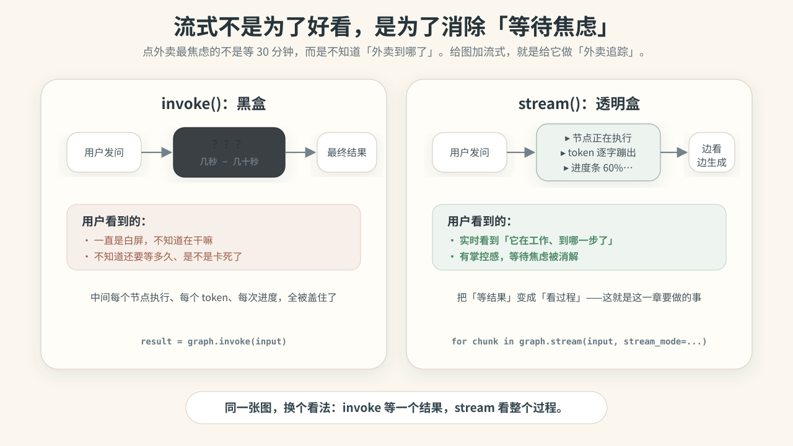
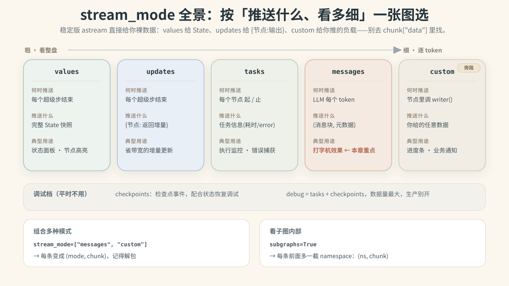

# LG-07：流式输出 —— 把「等结果」变成「看过程」

> **核心冲突句：`invoke()` 是个黑盒——用户发问后只能盯着白屏干等几秒到几十秒，中间每个节点执行、每个 token、每次进度全被盖住。流式不改变图做什么，只改变你「怎么看」它：让过程实时推送到用户眼前。**

这一章只讲一件事：同一张图，怎么从「等一个最终结果」变成「实时看到整个过程」。

## 0. 为什么需要流式：先从「等外卖」说起

点外卖时，你最焦虑的不是等 30 分钟，而是不知道「外卖到哪了」。所以平台给你显示：商家接单 → 骑手到店 → 已取餐 → 距你 500 米。等待时间没变，但焦虑没了——因为你**看到了过程**。

我们前面写的图都是「黑盒执行」：`graph.invoke(input)`，等几秒甚至几十秒，然后蹦出一个最终结果。这几十秒里用户完全不知道发生了什么。

<div style="max-width: 1040px; margin: 1rem auto;">
  
</div>

`graph.stream(...)` 不改变图做什么，只是把中间过程一条条交给你：节点什么时候跑、LLM 吐了哪个 token、进度到哪了。这一章就是学会按需求挑「看哪种过程」。

## 1. 全景：一张图先把 stream_mode 选型定下来

`stream()` / `astream()` 用一个 `stream_mode` 参数决定「推送什么」。先看整体，再逐个拆。

<div style="max-width: 1040px; margin: 1rem auto;">
  
</div>

| 模式 | 何时推送 | 推送什么（裸数据，直接拿） | 典型用途 |
|---|---|---|---|
| `values` | 每个超级步结束 | 完整 State（一个 dict） | 状态面板、节点高亮 |
| `updates` | 每个超级步结束 | `{节点名: 该节点的返回}` | 省带宽的增量更新 |
| `messages` | LLM 每个 token | `(消息块, metadata)` 元组 | 打字机效果（本章重点） |
| `custom` | 节点里调 `writer()` | 你推的任意数据 | 进度条、业务通知 |
| `tasks` | 每个节点 起 / 止 | 任务 dict（名字、耗时、error） | 执行监控、错误捕获 |
| `checkpoints` / `debug` | 检查点 / 全量 | 调试用，数据量大，平时不开 | 排查执行流程 |

> **一句话先记住：稳定版 `stream(stream_mode=...)` 直接 yield 裸数据。** values 就是 State，updates 就是 `{节点:输出}`，custom 就是你推的东西——**不要去 `chunk["data"]` 里找**（那是另一套实验 API 的信封，本章不用）。

## 2. 准备：一个最小演示图

先搭一个不带 LLM 的小图，用来观察 `values` / `updates` / `tasks` 这几种「看结构」的模式。它有两个并行节点（规划大纲、收集资料），再汇总生成内容——刚好能看出并行和顺序。

```python
from typing import TypedDict, Annotated
from operator import add
from langgraph.graph import StateGraph, START, END

# 真实 LLM 配置（messages 一节会用到），从项目根 .env 读取
from streaming_demo_support import chat_model


class WriterState(TypedDict):
    topic: str
    outline: str
    sources: list
    content: str
    log: Annotated[list, add]


def plan_outline(state: WriterState) -> dict:
    outline = f"1. {state['topic']}简介  2. 核心概念  3. 实战  4. 总结"
    return {"outline": outline, "log": ["大纲完成"]}


def gather_sources(state: WriterState) -> dict:
    sources = ["官方文档", "技术博客", "开源项目"]
    return {"sources": sources, "log": ["资料收集完成"]}


def generate_content(state: WriterState) -> dict:
    content = f"《{state['topic']}》正文…（依据：{state['outline']}）"
    return {"content": content, "log": ["内容生成完成"]}


builder = StateGraph(WriterState)
builder.add_node("plan_outline", plan_outline)
builder.add_node("gather_sources", gather_sources)
builder.add_node("generate_content", generate_content)
# plan_outline 与 gather_sources 从 START 并行出发，都完成后再进 generate_content
builder.add_edge(START, "plan_outline")
builder.add_edge(START, "gather_sources")
builder.add_edge("plan_outline", "generate_content")
builder.add_edge("gather_sources", "generate_content")
builder.add_edge("generate_content", END)
writer_graph = builder.compile()

demo_input = {"topic": "LangGraph 流式", "outline": "", "sources": [], "content": "", "log": []}
print("演示图已就绪，节点:", list(writer_graph.get_graph().nodes)[1:-1])
```

**输出**

```text
演示图已就绪，节点: ['plan_outline', 'gather_sources', 'generate_content']
```

## 3. `values`：每步推一份完整 State 快照

每个超级步结束，推一次**当前完整的 State**。`stream(stream_mode="values")` 直接 yield 那个 State dict——不用解任何信封。适合做「状态面板」：每来一帧，就刷新整个视图。

注意：每帧都是完整 State，State 很大时（比如 messages 很长）带宽不省。

```python
print("stream_mode='values' —— 每帧都是完整 State：\n")
for i, state in enumerate(writer_graph.stream(demo_input, stream_mode="values")):
    # state 就是 State dict 本身，直接用
    filled = {k: v for k, v in state.items() if v}
    print(f"第 {i} 帧已填字段: {list(filled)}")
```

**输出**

```text
stream_mode='values' —— 每帧都是完整 State：

第 0 帧已填字段: ['topic']
第 1 帧已填字段: ['topic', 'outline', 'sources', 'log']
第 2 帧已填字段: ['topic', 'outline', 'sources', 'content', 'log']
```

## 4. `updates`：只推「哪个节点、返回了什么」

`values` 每次给你整盘，`updates` 只给**这一步哪个节点、返回了什么增量**，形状是 `{节点名: 节点的返回值}`。State 大、只关心变化时用它，前端拿到后自己 merge。

并行节点同一步触发时，会各自出现在 `data` 里。

```python
print("stream_mode='updates' —— 只推变化的节点：\n")
for update in writer_graph.stream(demo_input, stream_mode="updates"):
    # update 形如 {节点名: 该节点返回的 dict}
    for node, payload in update.items():
        changed = [k for k, v in payload.items() if v and k != "log"]
        print(f"节点 {node:<16} 更新了: {changed}")
```

**输出**

```text
stream_mode='updates' —— 只推变化的节点：

节点 gather_sources   更新了: ['sources']
节点 plan_outline     更新了: ['outline']
节点 generate_content 更新了: ['content']
```

## 5. `messages`：LLM 每个 token 实时蹦出（本章重点）

这是「打字机效果」的核心：LLM 每生成一个 token，立刻推给你。`stream(stream_mode="messages")` yield 的是 **`(消息块, metadata)` 元组**——直接解包，不是 `chunk["data"]`。`metadata` 告诉你这个 token 来自哪个节点、第几步。

下面接**真实 LLM**（读 `.env` 配置）跑一次，亲眼看到逐字输出。

```python
from langchain_core.messages import HumanMessage
from langgraph.graph import MessagesState


def writer_llm(state: MessagesState) -> dict:
    # 节点内正常调用 LLM；stream_mode="messages" 会自动捕获它产生的 token
    return {"messages": [chat_model.invoke(state["messages"])]}


chat_builder = StateGraph(MessagesState)
chat_builder.add_node("writer", writer_llm)
chat_builder.add_edge(START, "writer")
chat_builder.add_edge("writer", END)
chat_graph = chat_builder.compile()

print("打字机效果（token 逐字蹦出）：\n")
full_text = ""
last_meta = {}
for token, metadata in chat_graph.stream(
    {"messages": [HumanMessage("用三句话介绍 LangGraph 的流式输出有什么用。")]},
    stream_mode="messages",
):
    print(token.content, end="", flush=True)  # 关键：追加，不是替换
    full_text += token.content
    last_meta = metadata

print(f"\n\n这些 token 来自节点: {last_meta.get('langgraph_node')}（第 {last_meta.get('langgraph_step')} 步）")
```

**输出**

```text
打字机效果（token 逐字蹦出）：

1. 流式输出允许在复杂工作流执行过程中实时返回中间结果，显著提升用户交互体验和响应速度。  
2. 它能逐步展示模型生成或节点计算的进展，便于开发者动态监控、调试和优化多步骤流程。  
3. 通过早期输出，可在满足条件时提前终止后续计算，从而节省资源并支持灵活的决策逻辑。

这些 token 来自节点: writer（第 1 步）
```

**两个必须记住的点：**

1. **token 是增量，前端要「追加」不是「替换」**：`full_text += token.content`。写成 `full_text = token.content` 就只剩最后一个字——这是最常见的 bug。
2. **只有走 LLM 的输出才有 token**：节点里直接 `return "字符串"`（不经过 ChatModel）不会触发 `messages` 事件。

## 6. `custom`：你在节点里主动推任意进度

前面几种都是 LangGraph 自动推的。`custom` 是**旁路**：你在节点里拿到 `writer`，想推什么推什么（进度百分比、"正在检索…"、中间结果）。`stream(stream_mode="custom")` yield 的就是**你推的那个对象本身**。

`writer` 用 `get_stream_writer()` 拿；只有 `stream_mode` 含 `custom` 时，这些推送才会流出来。

```python
from langgraph.config import get_stream_writer


class SearchState(TypedDict):
    progress: int


def search_with_progress(state: SearchState) -> dict:
    writer = get_stream_writer()
    sources = ["财经数据", "新闻", "竞品", "专家观点"]
    for i, source in enumerate(sources, 1):
        # 推什么，下游就原样收到什么
        writer({"stage": "搜索", "source": source, "percent": i / len(sources) * 100})
    return {"progress": 100}


sb = StateGraph(SearchState)
sb.add_node("search", search_with_progress)
sb.add_edge(START, "search")
sb.add_edge("search", END)
search_graph = sb.compile()

print("stream_mode='custom' —— event 就是你推的 dict 本身：\n")
for event in search_graph.stream({"progress": 0}, stream_mode="custom"):
    # 直接是 {"stage":..., "source":..., "percent":...}，没有外层信封
    print(f"[{event['stage']}] {event['source']:<6} {event['percent']:.0f}%")
```

**输出**

```text
stream_mode='custom' —— event 就是你推的 dict 本身：

[搜索] 财经数据   25%
[搜索] 新闻     50%
[搜索] 竞品     75%
[搜索] 专家观点   100%
```

## 7. `tasks`：每个节点的「开始 / 结束」自动追踪

不用你手动推，LangGraph 在每个节点 **start** 和 **finish** 各推一次。形状也是裸 dict：
- 开始：`{"id", "name", "input", "triggers"}`
- 结束：`{"id", "name", "result", "error", "interrupts"}`

区分开始/结束就看有没有 `result` 键。两次的时间差就是该节点耗时；`error` 字段在失败时自动带上错误——天然适合做监控和错误捕获。

```python
import time

print("stream_mode='tasks' —— 节点生命周期 + 耗时：\n")
started = {}
for ev in writer_graph.stream(demo_input, stream_mode="tasks"):
    # ev 是裸 dict，开始事件没有 'result'，结束事件有
    if "result" not in ev:
        started[ev["id"]] = time.perf_counter()
        print(f"▶ 开始  {ev['name']}")
    else:
        cost = time.perf_counter() - started.get(ev["id"], time.perf_counter())
        if ev["error"]:
            print(f"✗ 失败  {ev['name']}: {ev['error']}")
        else:
            print(f"✓ 完成  {ev['name']}  (耗时 {cost*1000:.1f} ms)")
```

**输出**

```text
stream_mode='tasks' —— 节点生命周期 + 耗时：

▶ 开始  gather_sources
▶ 开始  plan_outline
✓ 完成  gather_sources  (耗时 0.9 ms)
✓ 完成  plan_outline  (耗时 1.2 ms)
▶ 开始  generate_content
✓ 完成  generate_content  (耗时 0.4 ms)
```

## 8. `debug` / `checkpoints`：调试档，知道有就行

`debug` 把执行流程的每一步都吐出来（形状是 `{"step", "timestamp", "type", "payload"}`，`type` 是 `task` / `task_result` / `checkpoint`），数据量很大，**只在排查执行流程时用，生产别开**。`checkpoints` 则配合状态恢复调试。平时选型用不到它们，看一眼结构即可。

```python
print("stream_mode='debug' —— 每条带 step/type/payload：\n")
for ev in writer_graph.stream(demo_input, stream_mode="debug"):
    # 注意：这里的 ev['type'] 是 'task'/'task_result'，不是 'debug'
    print(f"step={ev['step']:>2}  type={ev['type']:<12} node={ev['payload'].get('name','-')}")
```

**输出**

```text
stream_mode='debug' —— 每条带 step/type/payload：

step= 1  type=task         node=gather_sources
step= 1  type=task         node=plan_outline
step= 1  type=task_result  node=gather_sources
step= 1  type=task_result  node=plan_outline
step= 2  type=task         node=generate_content
step= 2  type=task_result  node=generate_content
```

## 9. 组合多种模式：一次拿到打字机 + 进度条

真实 UI 常常既要打字机（`messages`）又要进度条（`custom`）。把 `stream_mode` 传一个**列表**就行。代价是：每条事件变成 **`(mode, chunk)` 元组**，你要先解包，再按 `mode` 分流。

```python
class ComboState(TypedDict):
    done: bool


def combo_node(state: ComboState) -> dict:
    writer = get_stream_writer()
    for pct in (0, 50, 100):
        writer({"percent": pct})
    return {"done": True}


cb = StateGraph(ComboState)
cb.add_node("combo", combo_node)
cb.add_edge(START, "combo")
cb.add_edge("combo", END)
combo_graph = cb.compile()

print("组合 stream_mode=['custom', 'tasks'] —— 每条是 (mode, chunk)：\n")
for mode, chunk in combo_graph.stream({"done": False}, stream_mode=["custom", "tasks"]):
    if mode == "custom":
        print(f"  [custom] 进度 {chunk['percent']}%")
    elif mode == "tasks":
        phase = "完成" if "result" in chunk else "开始"
        print(f"  [tasks]  {chunk['name']} {phase}")
```

**输出**

```text
组合 stream_mode=['custom', 'tasks'] —— 每条是 (mode, chunk)：

  [tasks]  combo 开始
  [custom] 进度 0%
  [custom] 进度 50%
  [custom] 进度 100%
  [tasks]  combo 完成
```

## 10. 子图嵌套：用 `subgraphs=True` 看进子图内部

当你用 `create_supervisor` / `create_swarm`（LG-06）或手动把子图当节点时，图是**嵌套**的。默认 `stream()` 只给顶层事件，子图内部是黑盒。

加 `subgraphs=True`，子图事件也会流出来——代价是每条事件前面**多一截 namespace**，变成 **`(ns, chunk)` 元组**：`()` 是顶层，子图则是 `("child:<内部id>",)` 这样的元组（冒号前是子图所在的节点名）。前端就靠这个 `ns` 决定「这条放主面板还是放子图详情面板」。

```python
class NumState(TypedDict):
    x: int


# 子图
def child_step(state: NumState) -> dict:
    return {"x": state["x"] + 1}

child_b = StateGraph(NumState)
child_b.add_node("child_step", child_step)
child_b.add_edge(START, "child_step")
child_b.add_edge("child_step", END)
child_graph = child_b.compile()

# 父图：把子图当成一个节点
def parent_step(state: NumState) -> dict:
    return {"x": state["x"] * 10}

parent_b = StateGraph(NumState)
parent_b.add_node("parent_step", parent_step)
parent_b.add_node("child", child_graph)
parent_b.add_edge(START, "parent_step")
parent_b.add_edge("parent_step", "child")
parent_b.add_edge("child", END)
parent_graph = parent_b.compile()

print("默认：子图内部是黑盒，只看到顶层")
for chunk in parent_graph.stream({"x": 1}, stream_mode="updates"):
    print("  ", chunk)

print("\nsubgraphs=True：每条变 (ns, chunk)，子图事件也出来了")
for ns, chunk in parent_graph.stream({"x": 1}, stream_mode="updates", subgraphs=True):
    # ns 形如 ("child:<内部id>",)，冒号前是子图所在的节点名
    where = "顶层图" if ns == () else "子图 " + "/".join(n.split(":")[0] for n in ns)
    print(f"  [{where}] ns={ns}  {chunk}")
```

**输出**

```text
默认：子图内部是黑盒，只看到顶层
   {'parent_step': {'x': 10}}
   {'child': {'x': 11}}

subgraphs=True：每条变 (ns, chunk)，子图事件也出来了
  [顶层图] ns=()  {'parent_step': {'x': 10}}
  [子图 child] ns=('child:4891c339-79c3-d301-7864-60a251c21b8b',)  {'child_step': {'x': 11}}
  [顶层图] ns=()  {'child': {'x': 11}}
```

## 11. 工程化：什么该流、什么不该流（够用就好）

流式不是越多越好。一个简单原则就能定大方向：

> **人读的东西流式，机器读的东西非流式。**

LLM 生成的自然语言是给人看的，逐字蹦能消除等待焦虑；工具调用参数、错误码、审批请求是给程序/决策用的，**片段没有意义**，要一次性完整给出。

| 输出 | 流式？ | 为什么 |
|---|---|---|
| LLM 自然语言内容 | ✅ 流 | 消除等待焦虑，提升体感速度 |
| 工具调用参数 / 结果 | ✗ 不流 | 结构化数据，碎片无意义 |
| 错误 / 中断审批 | ✗ 不流 | 要立即、完整呈现，供用户决策 |
| 进度通知 | ✗ 不流 | 一次推送状态即可（用 `custom`） |

至于 SSE / WebSocket 协议、消息信封字段设计这些，是**前端工程**的事，不属于 LangGraph 机制——真要落地时按你的前端框架来即可，这里不展开。

## 12. 常见误区

| 坑 | 现象 | 纠正 |
|---|---|---|
| 去 `chunk["data"]` 里取数据 | `KeyError` / 取不到 | 稳定版 `stream(stream_mode=...)` **直接给裸数据**：values 是 State，custom 是你推的 dict，tasks 是任务 dict |
| 用 `values` 做打字机 | 每帧整盘 State，要 diff 才知道新增啥 | 打字机必须用 `messages` |
| token 用「替换」 | 只显示最后一个字 | `text += token.content`，不是 `text = ...` |
| `custom` 的 `writer` 没在节点里调 | 没有任何自定义事件 | `writer` 必须在节点函数内部调用 |
| 嵌套子图看不到内部 | 只有顶层事件 | 加 `subgraphs=True`，按 `(ns, chunk)` 的 `ns` 区分来源 |
| 组合模式忘了解包 | 不知道是哪种 mode | 列表模式每条是 `(mode, chunk)`，先解包 |

> 调试技巧：拿不准某个模式 yield 什么，**先别接前端**，直接 `for chunk in graph.stream(..., stream_mode=X): print(type(chunk), chunk)` 看一眼真实形状。

## 13. 小结

把黑盒 `invoke` 换成 `stream`，就是把「等一个结果」变成「看整个过程」。选哪种过程，看你要给用户什么反馈：

```text
看 LLM 逐字生成   → messages
要进度百分比      → custom（节点里 writer()）
要节点起止/耗时   → tasks
要当前 State 全貌 → values
只要增量、省带宽  → updates
看子图内部        → 任意模式 + subgraphs=True
既要打字机又要进度 → stream_mode=["messages", "custom"]
```

记忆口诀：

> **values 看全局，updates 看变化，messages 看逐字，custom 看进度，tasks 看生命周期，subgraphs=True 看嵌套。**

而所有这些的共同前提一句话：**稳定版 stream 直接给你裸数据，组合加 (mode, …)，子图加 (ns, …)。**

## 14. 课后练习

1. 把 `messages` 那一节的问题换成一篇长文（如"写一段 200 字的科普"），观察打字机效果，并故意把 `+=` 写成 `=`，看会发生什么。
2. 给 §7 的 `tasks` 演示人为加一个会抛错的节点，确认 `error` 字段把错误自动带了出来。
3. 用 `stream_mode=["messages", "custom"]` 给 LLM 写作图加一个"正在生成…"的进度事件，同时跑出打字机 + 进度。
4. 用 LG-06 的 `create_supervisor` 搭一个多 Agent 系统，开 `subgraphs=True`，按 `ns` 把主管和各专家的事件分别打印。
5. 想一个「该用 `custom` 而不是 `messages`」的业务场景，并说明理由。

---

**下一节 LG-08**：多智能体系统与复杂工作流（DeepResearch Agent）——会用到这一章的 `subgraphs=True` + `ns`，把多层嵌套的执行过程做成一条可视化时间线。
